# 🌿 G.O.S. - Greenhouse Operating System
## High-Throughput Plant Phenotyping Platform

**Illuminate & Automate: Reinforcement Learning + IoT Sensor Array for LED-Steered Transpiration in Greenhouse Strawberries**

---

## 📋 Table of Contents

1. [What is G.O.S.?](#-what-is-gos)
2. [Hardware](#hardware)
3. [System Architecture](#-system-architecture)
4. [Data Flow Workflow](#-data-flow-workflow)
5. [Quick Start](#-quick-start)
6. [Testing & Verification](#-testing--verification)
7. [File Reference](#-file-reference)
8. [API Endpoints](#-api-endpoints)
9. [Hardware Integration](#-hardware-integration)

---

## 🎯 What is G.O.S.?

G.O.S. is an **open-source phenotyping platform** that transforms raw greenhouse sensor data into actionable plant insights:

| Feature | Description |
|:---|:---|
| **40 Wireless Nodes** | nRF52840 sensors (Thread mesh) |
| **VPD Calculation** | Real-time vapor pressure deficit |
| **Transpiration** | Penman-Monteith estimation |
| **Stress Detection** | Multi-factor scoring (0-100) |
| **LED Control** | RL-based spectral recommendations |
| **ML Pipeline** | 5-source temporal synchronization |

---

## Hardware

Two custom boards plus off-the-shelf parts. Both boards are 4-layer (two solid ground planes),
fully designed, DRC-clean and ready to order assembled from JLCPCB; none has been built yet.

| Piece | What it does | Where | Status |
|---|---|---|---|
| **Sensor node** (40 x 65 mm) | nRF52840 module running Zephyr RTOS and OpenThread; SHT40 temperature/humidity, TSL2591 light, 18650 battery with USB-C charging; sends a signed reading every 60 s; drives the LED board with two PWM signals | one per measurement point, in its own enclosure | [`pcbs/gos_sensor_node`](pcbs/gos_sensor_node) |
| **LED driver** (60 x 45 mm) | two AL8860 constant-current channels (blue 448 nm, red 655 nm strings, 333 mA) from a 24 V adapter, dimmed by the node's PWM | one per grow light, in its own enclosure at the light | [`pcbs/led_driver`](pcbs/led_driver) |
| Border router | Raspberry Pi + Nordic nRF52840 Dongle running the OpenThread border router; the `coap_receiver` service checks each packet's signature, writes it to TimescaleDB and answers with the node's signed LED command | one per phytotron | [`documentation/raspberry_pi_setup.md`](documentation/raspberry_pi_setup.md) |

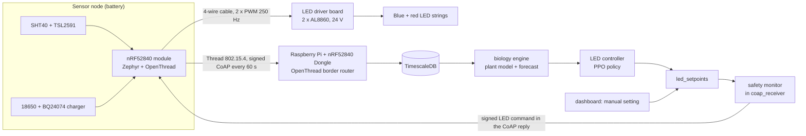

The loop is closed: every packet a node sends is answered with its LED level, signed with the
node's key and bound to that packet, after the safety monitor (dark period, over-temperature,
ramp limit). The node falls back to "off" if it hears nothing for 15 minutes.

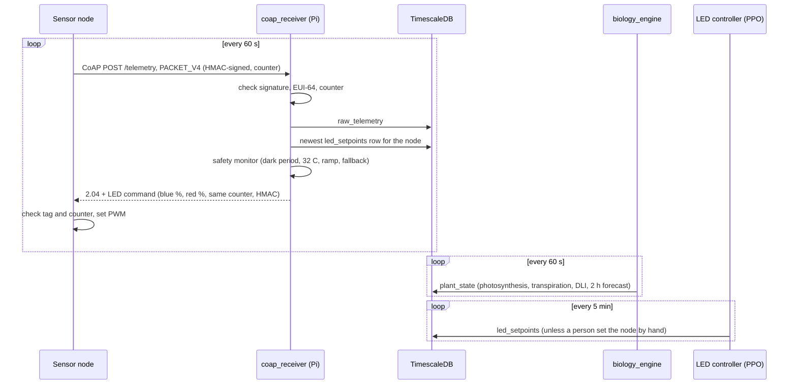

### Models

The decisions are made on the Pi, not on the node. Details, versions and checksums:
[`ml_engine/models/README.md`](ml_engine/models/README.md).

| Job | Model | Where the weights are | Result |
|---|---|---|---|
| What the plants are doing | strawberry canopy model (Farquhar + Medlyn + Penman-Monteith) | code | light-saturated photosynthesis 15.9 umol m-2 s-1, in the 15 to 20 reported for strawberry |
| LED levels | PPO reinforcement-learning policy, numpy on the Pi | `ml_engine/models/led_policy.npz` | within 0.5 % of a model-based optimiser on 60 held-out days |
| 2 h climate forecast | Chronos-Bolt Tiny (Amazon, Hugging Face), offline | `ml_engine/models/hf/` | VPD error at 6 h 0.118 kPa vs 0.245 for "no change" (a year of measured weather) |
| Notes to research events | Qwen2.5-1.5B-Instruct via Ollama, offline (Claude optional, rules as fallback) | [GitHub release](https://github.com/johnnietse/strawberry-farm/releases/tag/models-2026-11-15) | 6 of 6 test notes filed correctly |

| Plant model | LED policy over one held-out day |
|---|---|
|  |  |
|  |  |

### Boards

| Sensor node | LED driver |
|---|---|
|  |  |
| 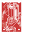 | 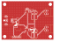 |

Bottom views, assembly drawings, courtyards, all layers and STEP models: `pcbs/*/docs/`.

<details>
<summary>Schematics (click to open)</summary>

Sensor node: [top level](docs/images/schematics/gos_sensor_node.svg) ·
[power](docs/images/schematics/gos_sensor_node-Power.svg) ·
[MCU](docs/images/schematics/gos_sensor_node-MCU.svg) ·
[sensors](docs/images/schematics/gos_sensor_node-Sensors.svg) ·
[connectors](docs/images/schematics/gos_sensor_node-Connectors.svg)

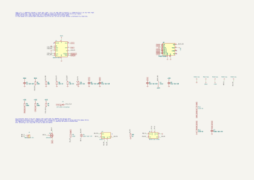
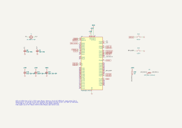

LED driver: [schematic](docs/images/schematics/led_driver.svg)

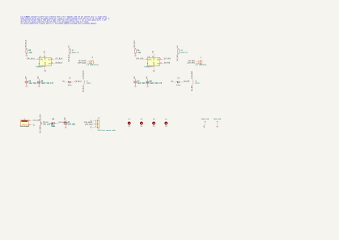

PDFs: `pcbs/gos_sensor_node/gos_sensor_node_schematic.pdf`, `pcbs/led_driver/led_driver_schematic.pdf`.
</details>

### Enclosures

| Sensor node (exploded) | LED driver (exploded) |
|---|---|
|  | 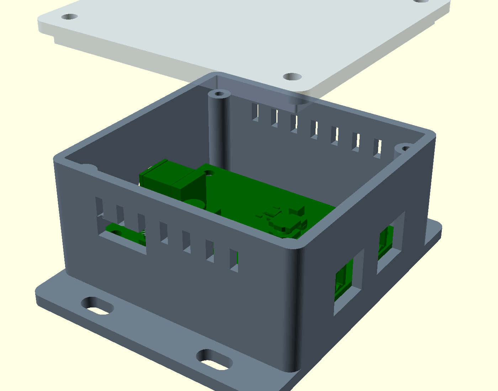 |
| 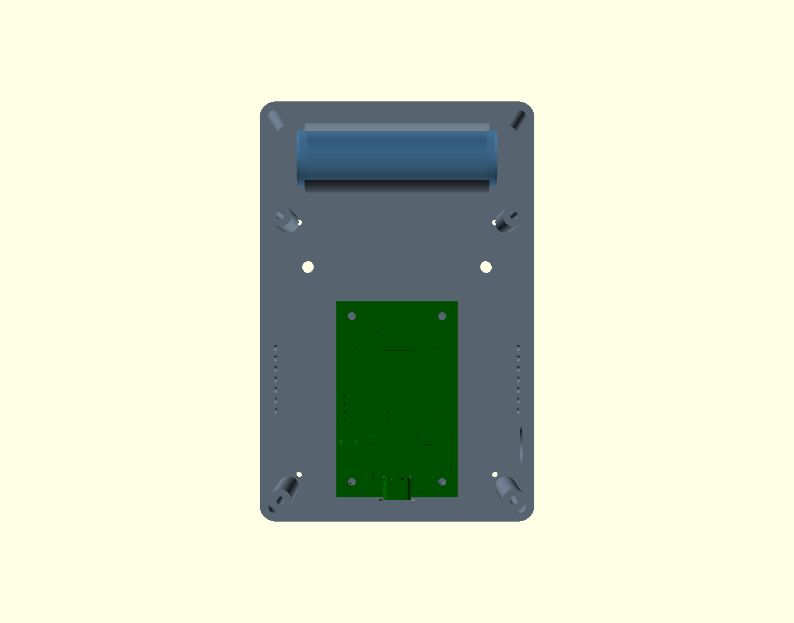 | 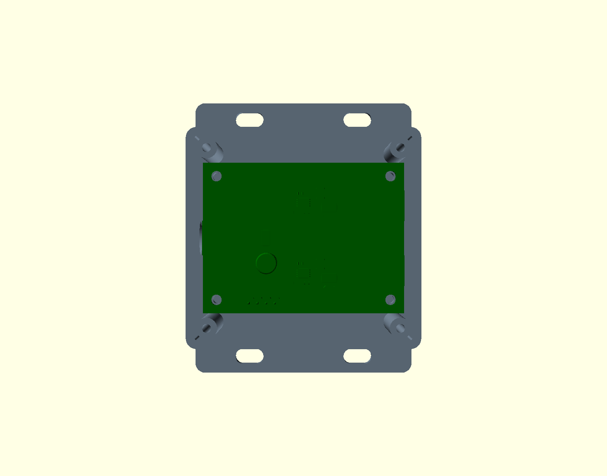 |

Generated from the KiCad boards and fit checked by [`mechanical/fit_check.py`](mechanical/fit_check.py);
print files in [`mechanical/print/`](mechanical/print) (ASA). Details: [`mechanical/README.md`](mechanical/README.md).

### Verification so far

| Check | Result |
|---|---|
| KiCad DRC, every severity, with schematic parity | 0 violations, 0 unrouted, 0 mismatches (both boards) |
| Layout review (USB pair, buck switching loop, antenna strip) | [`documentation/design_review.md`](documentation/design_review.md) |
| LTspice: LED current, switching frequency, PWM dimming, fail-safe, battery sense, reversed cell | all pass after two design fixes: [`simulation/README.md`](simulation/README.md) |
| Firmware build (Zephyr main, SDK 1.0.1) | no warnings, 214 KB flash, 62 KB RAM |
| Gateway tests (receiver, LED commands, safety monitor, assistant, API token, CORS, limits) | 79 pass |
| ML engine tests (plant model physics, task, policy, controller) | 13 pass |
| LED command check in firmware, host test against gateway-made commands | 8 pass |
| End-to-end in Docker with the production images (torch, Chronos loaded offline, Qwen2.5-1.5B): node to database to plant model and forecast to PPO controller to safety to signed command, verified by the node; dashboard and its /api proxy; token refusals; manual override with no expiry; assistant (`tests/e2e/run_e2e.sh`) | 14 of 14 checks pass |
| Enclosure fit | 12 checks pass |

| LED channel at 24 V (LTspice) | PWM dimming 50 % (LTspice) |
|---|---|
|  | 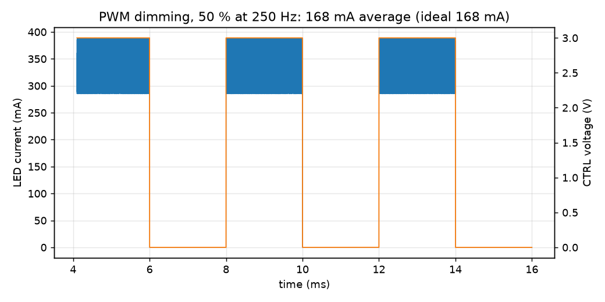 |

**Order it:** [`documentation/ordering.md`](documentation/ordering.md) (JLCPCB settings, every part with
stock, what to buy separately). **Build it:** [`documentation/bring_up.md`](documentation/bring_up.md).

---

## 🏗️ System Architecture

### Services (Docker Compose)

| Service | What it does | Code |
|---|---|---|
| `db` | TimescaleDB: telemetry, plant state, LED setpoints and commands, events, yield | `gateway/schema.sql` |
| `coap_receiver` (profile `hardware`) | Real nodes over Thread: verifies, stores, replies with the signed LED command after the safety monitor | `gateway/services/coap_receiver.py`, `led_safety.py` |
| `biology_engine` | Strawberry canopy model on live data each minute, daily light integral, 2 h climate forecast (Chronos-Bolt Tiny) | `ml_engine/biology_engine.py` |
| `ml_engine` | LED controller: PPO policy picks blue and red levels per node every 5 min | `ml_engine/controller.py` |
| `api` | REST API for the dashboard: nodes, plant state, LED control, events, assistant | `gateway/services/api.py` |
| `dashboard` | Web GUI on port 8080; nginx also forwards `/api/` to the API, so page and API share one address on any network | `dashboard/`, `dashboard/nginx.conf` |
| `ollama` (profile `assistant`) | Local language model (Qwen2.5-1.5B) for the research assistant, offline | `gateway/services/assistant.py` |
| `sync_engine` | Joins telemetry, met station, LED history, events and yield into the ML dataset | `gateway/services/sync.py` |
| `ingest`, `met_station` | Simulated 40 nodes and met station (switch off with real hardware) | `gateway/services/farm_sim.py`, `met_station.py` |
| `mqtt`, `mqtt_bridge` | MQTT input for other instruments | `gateway/services/mqtt_bridge.py` |
| `grafana` | Monitoring dashboards on port 3000 | `monitoring/` |


---

## 🔄 Data Flow Workflow

### Step-by-Step Data Journey

```
1. SENSOR LAYER
   └── Sensor nodes (rev 3.1) measure temperature, humidity, light (lux) and battery
   └── Send a signed CoAP packet (PACKET_V4) over Thread every 60 s

2. GATEWAY LAYER
   └── Raspberry Pi runs OTBR (OpenThread Border Router) with an nRF52840 Dongle
   └── coap_receiver checks the HMAC signature, EUI-64 and replay counter

3. INGESTION LAYER
   └── coap_receiver inserts each reading into raw_telemetry
       (lux, counter and charger flags in the payload column)
   └── mqtt_bridge.py handles MQTT sources (simulation, other instruments)

4. METEOROLOGICAL LAYER
   └── met_station.py logs pyranometer + spectrometer data
   └── Writes to met_station_data table

5. SYNCHRONIZATION LAYER
   └── sync.py runs every 5 minutes
   └── Performs 5-source temporal joins:
       ├── raw_telemetry (hardware)
       ├── met_station_data (environment)
       ├── led_schedule_history (light control)
       ├── research_events (annotations)
       └── yield_logs (harvest data)
   └── Outputs curated_research_dataset.csv

6. PLANT MODEL (biology_engine, every minute)
   └── Photosynthesis, stomatal conductance, transpiration, VPD per node
       (Farquhar / Medlyn / Penman-Monteith), daily light integral
   └── 2 h temperature / humidity / VPD forecast (Chronos-Bolt Tiny)
   └── Writes plant_state

7. LED CONTROL (ml_engine, every 5 minutes)
   └── PPO policy (trained in the plant model) picks blue / red levels per node
   └── Writes led_setpoints; a manual setting from the dashboard takes priority
   └── coap_receiver sends each node its level in the reply to its next packet,
       after the safety monitor, signed with the node's key; logged in led_commands

8. VISUALIZATION LAYER
   └── dashboard/ shows nodes, plant state, LED commands and events, sets LEDs by hand
   └── Research assistant turns free-text notes into events (local LLM, Claude or rules)
   └── Grafana provides monitoring dashboards
```

---

## 🚀 Quick Start

### Prerequisites
- Docker Desktop 24+
- Python 3.11+
- 8GB RAM minimum

### Installation

```bash
git clone https://github.com/johnnietse/strawberry-farm.git
cd strawberry-farm
cp .env.example .env          # set passwords and GOS_API_TOKEN (needed for any change)
python -c "import secrets; print(secrets.token_hex(24))"
docker compose up -d --build
docker compose --profile assistant up -d ollama
OLLAMA="docker compose exec -T ollama ollama" bash ml_engine/models/fetch_models.sh
```

Open `http://<this machine>:8080`, click **Access** at the top right and paste the token once.

### Running the System

```bash
# Start all services
python run.py --up

# Check service status
python run.py --status

# View sync engine logs
python run.py --logs backbone

# View ML engine logs
python run.py --logs ai

# Stop all services
python run.py --down

# Clean (removes all data!)
python run.py --clean
```

### Access Points

| Service | URL | Reachable from | Credentials |
|:---|:---|:---|:---|
| Dashboard (and API at `/api/`) | http://PI-ADDRESS:8080 | any network the Pi is on | token for changes |
| API (scripts) | http://PI-ADDRESS:5000 | any network the Pi is on | token for changes |
| Grafana | http://PI-ADDRESS:3000 | any network the Pi is on | admin / `.env` |
| Database | localhost:5432 | the Pi only (`DB_BIND`) | `.env` |
| MQTT | localhost:1883 | the Pi only (`MQTT_BIND`) | anonymous |

Using it on other Wi-Fi networks, from other sites or another server:
[`documentation/network_and_access.md`](documentation/network_and_access.md).

---

## 🧪 Testing & Verification

### 1. Verify Docker Services

```bash
# Check all containers are running
docker compose ps

# Expected: every service "Up" (coap_receiver and ollama only with their profiles)
```

### 2. Test Database Connection

```bash
# Connect to database
docker exec -it stawberry_farm-db-1 psql -U researcher -d strawberry_research

# Check tables exist
\dt

# Query sample data
SELECT COUNT(*) FROM raw_telemetry;
SELECT * FROM raw_telemetry ORDER BY time DESC LIMIT 5;
```

### 3. Test API Endpoints

```bash
# Get node status
curl http://localhost:5000/api/nodes

# Calculate phenotype
curl -X POST http://localhost:5000/api/phenotype \
  -H "Content-Type: application/json" \
  -d '{"temp_c": 25.0, "humidity_pct": 65.0, "par_umol": 800.0}'

# Get phenotype summary
curl http://localhost:5000/api/phenotype/summary

# Log a research event
curl -X POST http://localhost:5000/api/event \
  -H "Content-Type: application/json" \
  -d '{"type": "pest", "description": "Spider mites on row 3", "severity": 2}'
```

### 4. Test Data Pipeline

```bash
# Wait 5 minutes for sync cycle, then check:
ls -la data/

# Should see: curated_research_dataset.csv
```

### 5. Automated tests

```bash
cd gateway && python -m pytest tests && cd ..          # receiver, LED commands, safety, assistant
cd ml_engine && python -m pytest tests && cd ..        # plant model, policy, controller
bash tests/e2e/run_e2e.sh                              # whole loop in Docker, simulated node
```

### 6. Test MQTT (Real Hardware)

```bash
# Subscribe to all topics
mosquitto_sub -h localhost -t "gos/#" -v

# Publish test message
mosquitto_pub -h localhost -t "gos/node/test01/telemetry" \
  -m '{"temp_c": 24.5, "humidity_pct": 62.0, "par_umol": 750}'
```

---

## 📂 File Reference

### Root Directory

| File | Purpose |
|:---|:---|
| `docker-compose.yml` | Orchestrates the Docker services |
| `run.py` | CLI tool for system management |
| `setup.bat` | Windows environment setup |
| `requirements.txt` | Python dependencies |
| `.env.example` | Environment variable template |

### gateway/ - Data Backbone Services

| File | Purpose | Writes To |
|:---|:---|:---|
| `schema.sql` | Database schema (6 hypertables) | TimescaleDB |
| `services/sync.py` | 5-source temporal joins | `data/curated_*.csv` |
| `services/api.py` | REST API + phenotype endpoints | — |
| `services/mqtt_bridge.py` | MQTT → Database | `raw_telemetry` |
| `services/farm_sim.py` | 40-node sensor simulation | `raw_telemetry` |
| `services/met_station.py` | Met station simulation | `met_station_data` |
| `services/coap_receiver.py` | Receives signed packets from real sensor nodes over Thread | `raw_telemetry` |
| `tools/provision_node.py` | Creates a node's signing key and its `credentials.conf` | `secrets/node_keys.json` |
| `services/led_safety.py` | LED safety monitor (dark period, over-temperature, ramp limit); applied to every LED command | `led_commands` |
| `services/assistant.py` | Research assistant: free-text note to structured event (Qwen via Ollama, Claude, or rules) | `research_events` |
| `Dockerfile` | Container build | — |
| `requirements.txt` | Python deps | — |

### ml_engine/ - Plant model, LED controller, forecast

Details and results: [`ml_engine/README.md`](ml_engine/README.md).

| File | Purpose |
|:---|:---|
| `plant_model.py` | Strawberry canopy model: photosynthesis, conductance, transpiration, spectrum |
| `biology_engine.py` | Service: plant model and forecast on live data, writes `plant_state` |
| `greenhouse_env.py`, `train_rl.py` | Lighting task and PPO training (PC) |
| `policy.py`, `models/led_policy.npz` | Trained LED policy, numpy inference |
| `controller.py` | Service: LED setpoints per node |
| `forecaster.py`, `eval_forecast.py` | Climate forecast backends and their evaluation |
| `phenotyping.py` | VPD, transpiration and stress helpers for the API |

### pcbs/gos_sensor_node/ - Sensor Node Hardware and Firmware (rev 3.1)

| Path | Purpose |
|:---|:---|
| `HARDWARE.md` | Design reference: pin map, power, signing, sources |
| `generate_schematics.py`, `generate_pcb.py` | Generate the KiCad schematic and board |
| `route_pcb.py` | Autoroute (Freerouting), ground planes and stitching, DRC, write `fab/` (Gerbers, drill, JLCPCB BOM and placement) and `docs/` (PDFs, renders, STEP) |
| `review_layout.py` | Measure the USB pair, buck switching loop and antenna strip |
| `fab/`, `docs/` | Order files; assembly, courtyard, user-layer and all-layer PDFs, renders, STEP |
| `firmware/` | Zephyr firmware to build and flash (`raytac_mdbt50q_db_40/nrf52840`) |

### pcbs/led_driver/ - LED Driver Board (rev 1.0)

| Path | Purpose |
|:---|:---|
| `README.md` | Design choices, ratings, recommended LEDs |
| `generate_schematic.py`, `generate_pcb.py` | Generate the KiCad schematic and board (routed with `../gos_sensor_node/route_pcb.py`) |
| `fab/`, `docs/` | Order files and documentation outputs |

### mechanical/ - Enclosures

| Path | Purpose |
|:---|:---|
| `enclosure_gen.scad`, `led_enclosure.scad` | Sensor node and LED driver enclosures (OpenSCAD) |
| `fit_check.py` | Generate board positions from KiCad, check the fit, render, export print files |
| `print/` | Print-ready STL files |

### simulation/ - LTspice

| Path | Purpose |
|:---|:---|
| `*.cir` | LED channel, PWM dimming, CTRL fail-safe, battery sense, reversed cell |
| `README.md`, `plots/` | Results and plots |

### firmware/ - Legacy rev 2 research firmware (does not build for current hardware; see `firmware/README.md`)

| File | Purpose |
|:---|:---|
| `src/main.c` | Main firmware (Zephyr RTOS + CoAP) |
| `prj.conf` | Zephyr config (SED mode, sensors) |
| `CMakeLists.txt` | Build system |
| `boards/nrf52840_phytotron.overlay` | Device tree (I2C, PWM, ADC) |
| `drivers/led_control.c` | PWM LED driver |
| `include/*.h` | Header files (7 files) |

### dashboard/ - Web GUI

| File | Purpose |
|:---|:---|
| `index.html` | Main UI |
| `css/style.css` | Styling |
| `js/dashboard.js` | Data fetching, node display |
| `js/dashboard.js` | Live data from the API, manual LED control, research assistant |

### monitoring/ - Observability

| File | Purpose |
|:---|:---|
| `grafana/provisioning/datasources/timescaledb.yml` | Grafana → DB connection |
| `mosquitto/config/mosquitto.conf` | MQTT broker config |

### documentation/ - Hardware Guides

| File | Purpose |
|:---|:---|
| `raspberry_pi_setup.md` | OTBR installation |
| `nrf52840_pinout.md` | Pin map and assembly guide (rev 3.1) |
| `hardware_specs.md` | Board and LED board summary (rev 3.1) |
| `design_review.md` | Electrical, firmware and mechanical review with the evidence for each finding |
| `issues_log.md` | Every issue found, its effect, and its status |
| `network_and_access.md` | Ports, the API token, other networks, other sites and servers |
| `archive/` | Rev 2 hardware documents, kept for reference |
| `bench_testing.md` | Validation procedures |
| `bring_up.md` | First power-on of a rev 3.1 sensor node, step by step |
| `ordering.md` | Ordering both boards assembled from JLCPCB: settings, part stock, items bought separately |
| `hardware_protocol.md` | Communication protocol |
| `requirements.md` | ELEC 490/498 checklist |

---

## 📡 API Endpoints

Reads need no credentials. Every change (POST / DELETE) needs `Authorization: Bearer <GOS_API_TOKEN>`
(set it in `.env`; without it the API is read-only, because `/api/led` drives real lights). The
dashboard asks for the token once and keeps it in the browser. Other web sites may call the API
from a browser only if listed in `GOS_CORS_ORIGINS` (`*` = any; they still need the token to
change anything). Manual LED settings can be timed (up to 90 days) or kept until switched back
(`"minutes": 0`). Assistant limits: 8000 characters, 30 requests per minute per client
(settings). Details: [`documentation/network_and_access.md`](documentation/network_and_access.md).

### Phenotyping

| Method | Endpoint | Description |
|:---|:---|:---|
| POST | `/api/phenotype` | Calculate VPD, transpiration, stress from sensor data |
| GET | `/api/phenotype/summary` | Greenhouse-wide summary (last hour) |

### Data Input (Group 2 GUI)

| Method | Endpoint | Description |
|:---|:---|:---|
| POST | `/api/event` | Log research event (pest, fertilizer, equipment) |
| POST | `/api/yield` | Log harvest yield data |
| POST | `/api/led` | Set LEDs by hand: `{"node": "RF-NODE-01" or "ALL", "blue_pct", "red_pct", "minutes"}` |
| DELETE | `/api/led/override` | End manual settings (`?node=` for one node); the controller takes over |
| POST | `/api/assistant` | `{"text": "...", "commit": true}`: note to structured research event |

### Data Output

| Method | Endpoint | Description |
|:---|:---|:---|
| GET | `/api/nodes` | Get all node status |
| GET | `/api/events` | Get recent events |
| GET | `/api/curated` | Download ML-ready dataset (CSV) |
| GET | `/api/plant` | Latest plant state per node (biology engine) with the active LED setpoint |
| GET | `/api/led/commands` | LED commands sent to the nodes, after the safety monitor |

### Health

| Method | Endpoint | Description |
|:---|:---|:---|
| GET | `/health` | Service health check |

---

## 🔧 Hardware Integration

### For Real Hardware Deployment

1. **Order the boards and parts:** [`documentation/ordering.md`](documentation/ordering.md).
2. **Border router:** [`documentation/raspberry_pi_setup.md`](documentation/raspberry_pi_setup.md)
   (OTBR + nRF52840 Dongle, network settings matching the node firmware).
3. **Provision, build and flash each node** (from the repo root, with a Zephyr workspace):
   ```bash
   python gateway/tools/provision_node.py --index 1 --network-key <32 hex digits>
   west build -b raytac_mdbt50q_db_40/nrf52840 pcbs/gos_sensor_node/firmware
   west flash
   ```
4. **Start the receiver** on the Pi: `docker compose --profile hardware up -d coap_receiver`.
5. **Bring-up and checks:** [`documentation/bring_up.md`](documentation/bring_up.md) (power, charger,
   sensors, Thread, database, LED board, sleep current, enclosures).
6. **Switch off the simulator:** comment out the `ingest` service in `docker-compose.yml`.

---

## Requirements, Implementation, and Status

| Requirement | Implementation | Status |
|:---|:---|:---:|
| Data backbone pipeline | `sync.py` - 5-source joins | ✅ |
| PostgreSQL database | TimescaleDB hypertables | ✅ |
| Docker orchestration | Compose: 11 services, plus `hardware` and `assistant` profiles | ✅ |
| 40 wireless nodes | Thread mesh; sensor node rev 3.1 designed, ready to order, not yet built | in progress |
| Preserved sample identity | EUI64 in all tables | ✅ |
| Group 2 GUI | Dashboard + LLM | ✅ |
| ML-ready datasets | `/api/curated` | ✅ |
| Phenotyping | VPD, transpiration | ✅ |
| Plant model (biology engine) | `ml_engine/plant_model.py`, `biology_engine.py`: FvCB, Medlyn, Penman-Monteith on live data | ✅ (tested; parameters not yet calibrated on real plants) |
| RL model (stretch) | `ml_engine/controller.py`: PPO policy closes the loop to the LEDs through signed CoAP replies | ✅ (simulation and end-to-end test; not yet on real plants) |
| Climate forecast | Chronos-Bolt Tiny (Hugging Face), evaluated on a year of measured weather | ✅ |

---


