# G.O.S. - Greenhouse Operating System

**Wireless climate sensing and LED spectrum control for research strawberries in a phytotron.**

Sensor nodes measure temperature, humidity and light at the plants and send signed readings over
a Thread radio network to a Raspberry Pi. On the Pi, a strawberry canopy model works out what
the plants are doing, a trained controller picks a blue/red LED mix for each grow light, and the
answer goes back to each node, signed, in the reply to its next reading. Researchers watch and
annotate everything in a web dashboard; the data ends up in one ML-ready dataset.

**Status (2026-11-15):** both circuit boards are designed, simulated and ready to order; the
firmware builds; all software is tested end to end against a simulated node. Nothing has run on
real boards or plants yet. What is and is not verified: [Verification](#verification).
Review of how the parts fit together, and what to change next:
[`documentation/system_review.md`](documentation/system_review.md).

- [How it works](#how-it-works)
- [Hardware](#hardware)
- [Software and models](#software-and-models)
- [Run it](#run-it)
- [Dashboard, API, network](#dashboard-api-network)
- [Verification](#verification)
- [Repository map](#repository-map)

---

## How it works

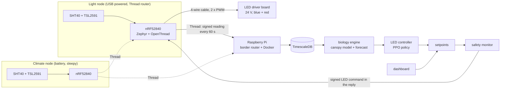

Two kinds of sensor node, same board, different firmware build:

| Node | Power | Thread role | Job |
|---|---|---|---|
| **Light node** | 5 V USB-C adapter | router: radio always on, relays for others | measures, and drives one LED driver board |
| **Climate node** | 18650 cell (months) | sleepy end device: wakes once a minute | measures only |

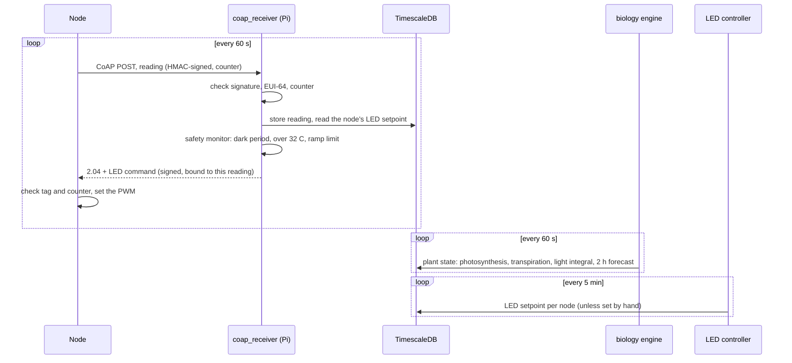

If a node hears nothing for 15 minutes it switches its LEDs off; if the cable is unplugged the
LED board's pull-downs keep the LEDs off.

---

## Hardware

| Piece | What it is | Docs |
|---|---|---|
| **Sensor node** rev 3.1, 40 x 65 mm, 4 layers | Raytac MDBT50Q (nRF52840) module; SHT40 temperature and humidity; TSL2591 light; 18650 cell with BQ24074 USB-C charger, DW01A/FS8205A protection, reverse-cell FET; TPS62740 3.3 V buck; 4-pin LED cable connector | [`pcbs/gos_sensor_node/HARDWARE.md`](pcbs/gos_sensor_node/HARDWARE.md) |
| **LED driver** rev 1.0, 60 x 45 mm, 4 layers | two AL8860 constant-current channels, 333 mA, 24 V input; blue 448 nm and red 655 nm strings of 4 LEDs; off when the control cable is unplugged | [`pcbs/led_driver/README.md`](pcbs/led_driver/README.md) |
| **Border router** | Raspberry Pi + Nordic nRF52840 Dongle (OpenThread border router); runs all the software in Docker | [`documentation/raspberry_pi_setup.md`](documentation/raspberry_pi_setup.md) |
| **Enclosures** | printed in ASA, generated from the KiCad boards and fit-checked | [`mechanical/README.md`](mechanical/README.md) |

| Sensor node | LED driver |
|---|---|
| 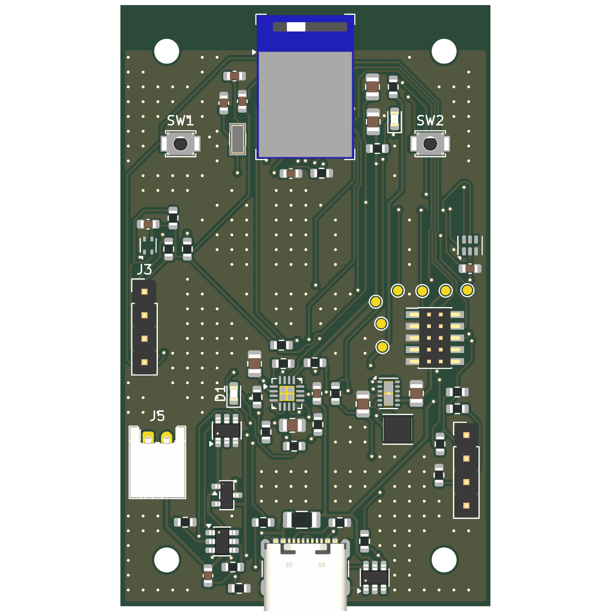 | 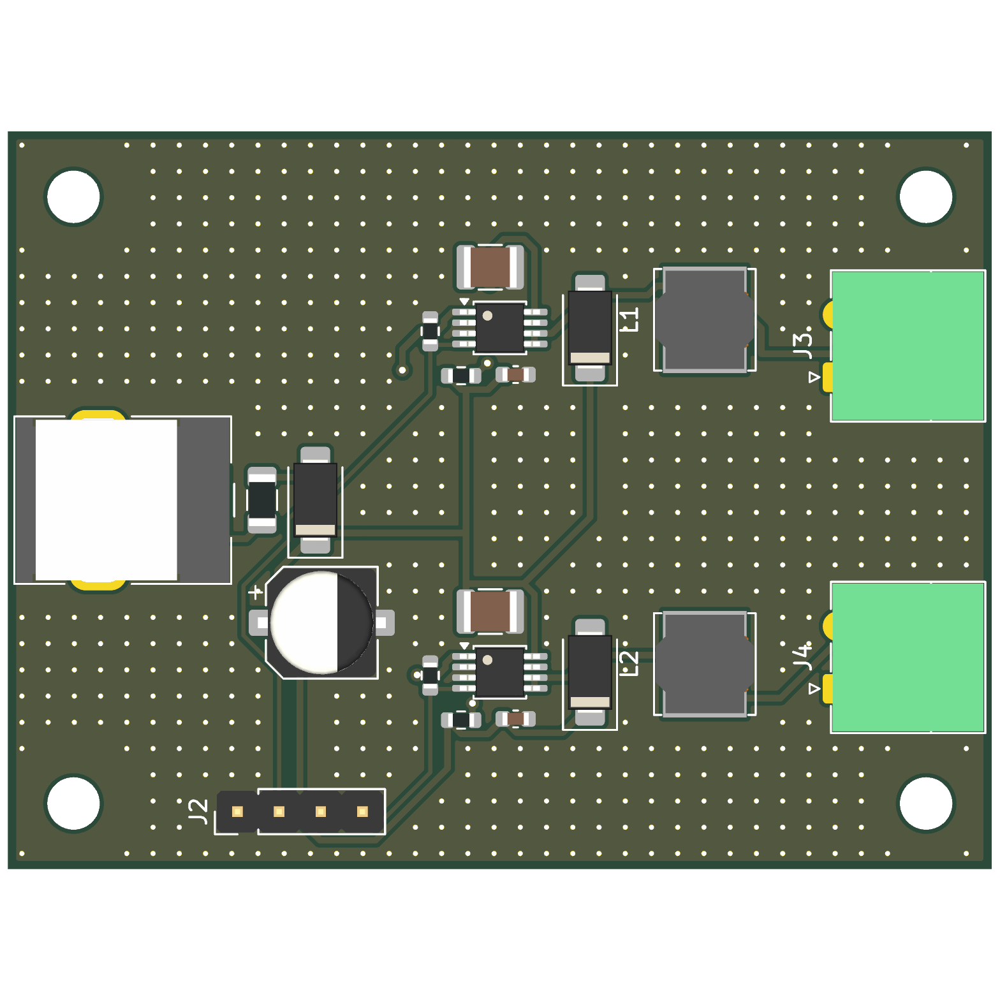 |
|  |  |
| 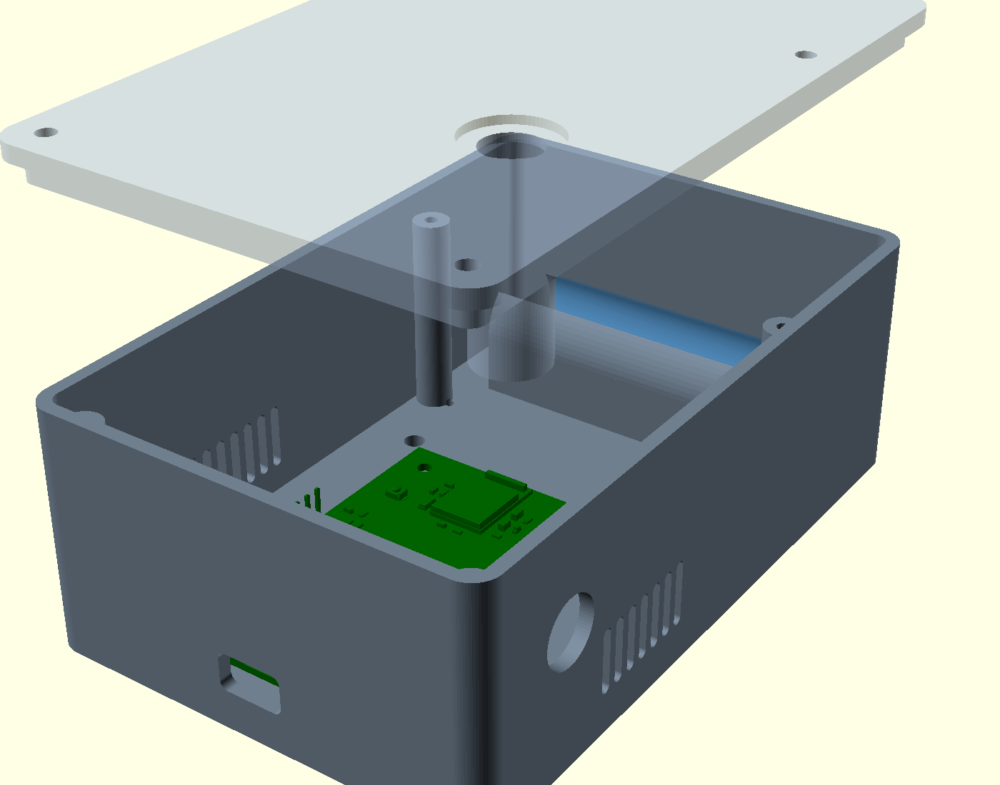 |  |

<details>
<summary>Schematics</summary>

Sensor node: [top level](docs/images/schematics/gos_sensor_node.svg) ·
[power](docs/images/schematics/gos_sensor_node-Power.svg) ·
[MCU](docs/images/schematics/gos_sensor_node-MCU.svg) ·
[sensors](docs/images/schematics/gos_sensor_node-Sensors.svg) ·
[connectors](docs/images/schematics/gos_sensor_node-Connectors.svg) ·
LED driver: [schematic](docs/images/schematics/led_driver.svg)


</details>

**Firmware** (Zephyr, [`pcbs/gos_sensor_node/firmware`](pcbs/gos_sensor_node/firmware)):

| Build | For | `west build -b raytac_mdbt50q_db_40/nrf52840 pcbs/gos_sensor_node/firmware ...` | Flash / RAM |
|---|---|---|---|
| bench | first power-on, with logging | (nothing more) | 214.6 / 62.4 KB |
| climate node | battery, in the phytotron | `-- -DEXTRA_CONF_FILE=low_power.conf` | 197.3 / 60.1 KB |
| climate node, locked | same, debugger blocked so keys cannot be read | `-- -DEXTRA_CONF_FILE="low_power.conf;lock.conf"` | 197.3 / 60.1 KB |
| light node | USB powered, Thread router | `-- -DEXTRA_CONF_FILE=router.conf` | 261.6 / 70.6 KB |

**Order and build:** [`documentation/ordering.md`](documentation/ordering.md) (JLCPCB settings,
every part with its stock, what to buy separately), then
[`documentation/bring_up.md`](documentation/bring_up.md) (first power-on, step by step).

**Known limits of this revision** (details and proposals in `system_review.md`): one LED board
adds about 120 umol m-2 s-1 over 0.25 m2, a spectral treatment rather than a main grow light; the
TSL2591 measures lux, so daylight PAR is estimated; the charger warms the SHT40 while charging
(those readings are flagged).

---

## Software and models

All on the Raspberry Pi, in Docker Compose:

| Service | What it does | Code |
|---|---|---|
| `db` | TimescaleDB: readings, plant state, LED setpoints and commands, events, harvests | [`gateway/schema.sql`](gateway/schema.sql) |
| `coap_receiver` (profile `hardware`) | receives node readings over Thread, checks signatures and counters, stores them, replies with each node's signed LED command after the safety monitor | [`gateway/services/coap_receiver.py`](gateway/services/coap_receiver.py), [`led_safety.py`](gateway/services/led_safety.py) |
| `biology_engine` | canopy model on live data each minute, daily light integral, 2 h climate forecast | [`ml_engine/biology_engine.py`](ml_engine/biology_engine.py) |
| `ml_engine` | LED controller: PPO policy picks blue and red levels per node every 5 min | [`ml_engine/controller.py`](ml_engine/controller.py) |
| `sync_engine` | joins readings, LED commands, plant state, met data, events and harvests into one ML-ready CSV | [`gateway/services/sync.py`](gateway/services/sync.py) |
| `api` | REST API | [`gateway/services/api.py`](gateway/services/api.py) |
| `dashboard` | web dashboard on port 8080; also forwards `/api/` to the API | [`dashboard/`](dashboard) |
| `grafana` | time-series dashboard (temperature, humidity, VPD, photosynthesis, transpiration, light integral, LED levels, battery) on port 3000 | [`monitoring/`](monitoring) |
| `ollama` (profile `assistant`) | local language model for the research assistant, offline | [`gateway/services/assistant.py`](gateway/services/assistant.py) |
| `ingest`, `met_station` (profile `sim`) | simulated 40 nodes and met station, for a demo on a PC without hardware | `gateway/services/farm_sim.py`, `met_station.py` |
| `mqtt`, `mqtt_bridge` | MQTT input for other instruments (local only by default) | `gateway/services/mqtt_bridge.py` |

| Job | Model | Weights | Result |
|---|---|---|---|
| What the plants are doing | strawberry canopy model: Farquhar photosynthesis, Medlyn stomata, Penman-Monteith transpiration | code | light-saturated photosynthesis 15.9 umol m-2 s-1, inside the 15 to 20 reported for strawberry |
| LED levels | PPO reinforcement-learning policy, trained in the canopy model, numpy on the Pi | [`ml_engine/models/led_policy.npz`](ml_engine/models) | within 0.5 % of a model-based optimiser on 60 held-out days |
| 2 h climate forecast | Chronos-Bolt Tiny (Amazon, Hugging Face), offline | [`ml_engine/models/hf/`](ml_engine/models/hf) | VPD error at 6 h 0.118 kPa, half of "no change" (0.245), on a year of measured weather |
| Notes to research events | Qwen2.5-1.5B-Instruct via Ollama, offline; Claude if a key is set; keyword rules otherwise | [GitHub release](https://github.com/johnnietse/strawberry-farm/releases/tag/models-2026-11-15) | 6 of 6 test notes filed correctly |

Model card with versions, licenses and checksums: [`ml_engine/models/README.md`](ml_engine/models/README.md).
Details and how to retrain: [`ml_engine/README.md`](ml_engine/README.md).

| Plant model | LED policy over one held-out day |
|---|---|
| 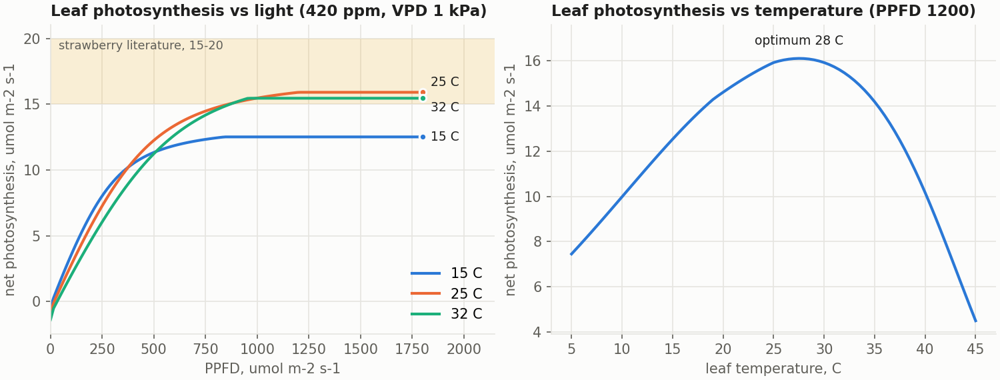 | 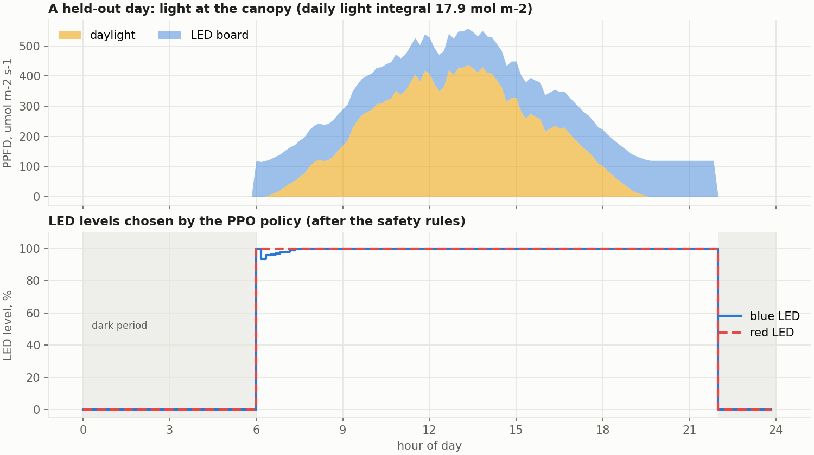 |
| 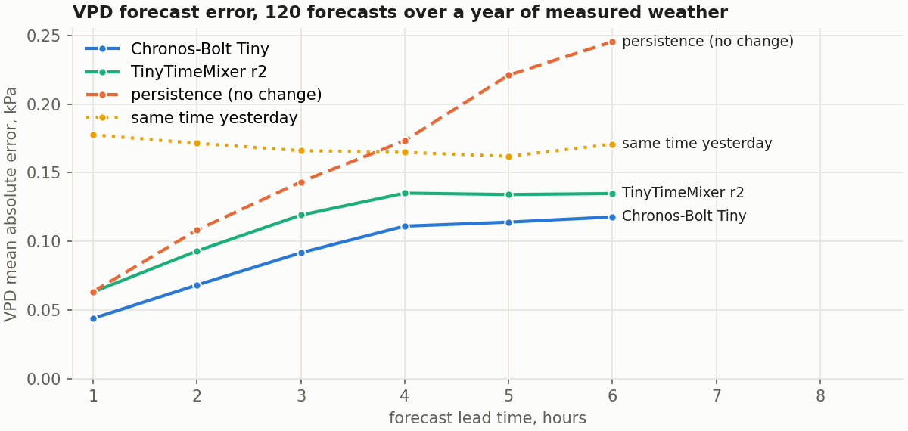 | 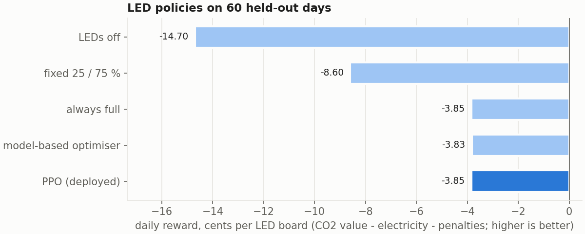 |

---

## Run it

**On a PC, without hardware** (simulated nodes):

```bash
git clone https://github.com/johnnietse/strawberry-farm.git
cd strawberry-farm
cp .env.example .env              # set the passwords and GOS_API_TOKEN
python -c "import secrets; print(secrets.token_hex(24))"     # a token for GOS_API_TOKEN
docker compose --profile sim up -d --build
```

Open http://localhost:8080, click **Access** at the top right and paste the token once.

**On the Raspberry Pi, with real nodes:** border router setup, then

```bash
docker compose --profile hardware --profile assistant up -d --build
OLLAMA="docker compose exec -T ollama ollama" bash ml_engine/models/fetch_models.sh
python gateway/tools/provision_node.py --index 1 --network-key <32 hex digits>   # per node
```

and flash each node with the build for its role (table above). Full guide:
[`documentation/raspberry_pi_setup.md`](documentation/raspberry_pi_setup.md), first power-on:
[`documentation/bring_up.md`](documentation/bring_up.md).

**Tests:**

```bash
cd gateway && python -m pytest tests && cd ..        # receiver, LED commands, safety, API, assistant
cd ml_engine && python -m pytest tests && cd ..      # canopy model, policy, controller
bash tests/e2e/run_e2e.sh                            # the whole loop in Docker, simulated node
```

---

## Dashboard, API, network

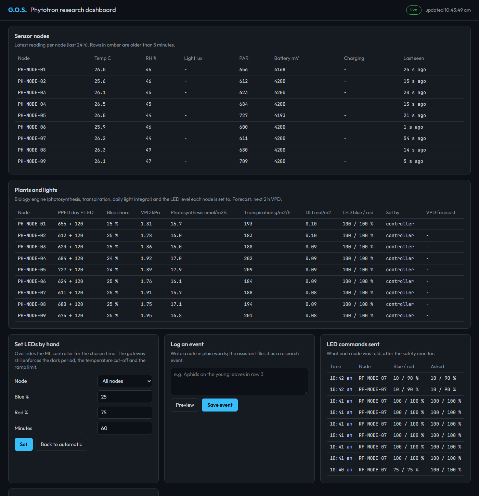

The dashboard shows each node, the plant state and forecast, the LED level each node was sent
(with any safety note) and recent events; it sets LEDs by hand (timed, or until switched back)
and turns free-text notes into research events.

| Method | Endpoint | |
|---|---|---|
| GET | `/api/nodes`, `/api/plant`, `/api/led/commands`, `/api/events`, `/api/curated` | node readings, plant state with LED setpoint and forecast, LED commands sent, events, the ML dataset (CSV) |
| GET | `/api/phenotype/summary`, `/health` | last-hour summary, health |
| POST | `/api/led` | set LEDs by hand: `{"node": "RF-NODE-01" or "ALL", "blue_pct", "red_pct", "minutes"}` (`0` = until switched back) |
| DELETE | `/api/led/override` | back to automatic (`?node=` for one node) |
| POST | `/api/event`, `/api/yield`, `/api/assistant`, `/api/phenotype` | log an event or harvest; note to event; VPD and stress for given values |

Reading needs nothing; every change needs `Authorization: Bearer <GOS_API_TOKEN>` (from `.env`;
without it the API is read-only). The dashboard and the API share port 8080, so the system works
at whatever address the Pi has, on any network. The database, MQTT and port 5000 are reachable
from the Pi only. Other networks, other web sites, another server, HTTPS:
[`documentation/network_and_access.md`](documentation/network_and_access.md).

---

## Verification

| Check | Result |
|---|---|
| KiCad DRC at every severity, with schematic parity | both boards: 0 violations, 0 unrouted |
| Layout review (USB pair, buck switching loop, antenna strip, LED switching loops) | measured; loops routed by hand ([`design_review.md`](documentation/design_review.md)) |
| LTspice: LED current and frequency, PWM dimming, CTRL fail-safe, battery sense, reversed cell | all pass after two fixes ([`simulation/README.md`](simulation/README.md)) |
| Datasheet checks: crystal load (nRF52840 LFXO table), TSL2591 decoupling, FS8205A pinout | match ([`HARDWARE.md`](pcbs/gos_sensor_node/HARDWARE.md#not-verified)) |
| Firmware: four builds, devicetree with `dtc` | no warnings from the project's code |
| Firmware LED-command check against commands made by the gateway (PC) | passes |
| Gateway tests | 81 pass |
| ML engine tests | 13 pass |
| End to end in Docker with the production images (torch, Chronos, Qwen): signed commands verified by the node, plant state and forecast, dashboard proxy, token refusals, manual override, assistant, ML dataset columns, Grafana | 17 of 17 checks pass |
| Enclosure fit | 12 checks pass |

| LED channel at 24 V (LTspice) | PWM dimming 50 % (LTspice) |
|---|---|
| 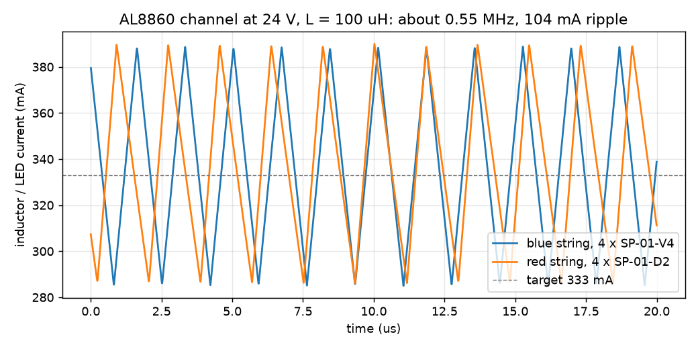 |  |

**Not verified yet (needs hardware):** sleep current and battery life, Thread range, charging,
the LED current and light output, the plant-model parameters for your cultivar, the forecast on
phytotron air. Every issue found so far and its status:
[`documentation/issues_log.md`](documentation/issues_log.md).

---

## Repository map

| Path | What |
|---|---|
| [`pcbs/gos_sensor_node/`](pcbs/gos_sensor_node) | sensor node: generators for schematic and board, routing, layout review, order files (`fab/`), drawings and renders (`docs/`), firmware |
| [`pcbs/led_driver/`](pcbs/led_driver) | LED driver board, same structure |
| [`mechanical/`](mechanical) | enclosures (OpenSCAD), fit check, print files |
| [`simulation/`](simulation) | LTspice netlists, results, plots |
| [`gateway/`](gateway) | database schema, receiver, safety monitor, API, assistant, curation, simulators, node provisioning, tests |
| [`ml_engine/`](ml_engine) | canopy model, biology engine, lighting task, PPO training and policy, controller, forecasters, models, tests |
| [`dashboard/`](dashboard) | web dashboard and its nginx configuration |
| [`monitoring/`](monitoring) | Grafana datasource and dashboard, MQTT broker configuration |
| [`tests/e2e/`](tests/e2e) | end-to-end test |
| [`documentation/`](documentation) | guides and reviews (below) |
| `firmware/` | legacy rev 2 firmware, kept for reference; does not build for the current board |

| Document | |
|---|---|
| [`system_review.md`](documentation/system_review.md) | how the parts fit together, deployment plan, proposals for revision 3.2 |
| [`design_review.md`](documentation/design_review.md) | electrical, firmware and mechanical review with evidence |
| [`issues_log.md`](documentation/issues_log.md) | every issue found, its effect and status |
| [`ordering.md`](documentation/ordering.md) | ordering both boards from JLCPCB, part stock, items bought separately |
| [`bring_up.md`](documentation/bring_up.md) | first power-on and bench tests |
| [`raspberry_pi_setup.md`](documentation/raspberry_pi_setup.md) | border router and the software stack |
| [`network_and_access.md`](documentation/network_and_access.md) | ports, token, other networks, sites and servers |
| [`hardware_protocol.md`](documentation/hardware_protocol.md) | reading packet and LED command formats |
| [`hardware_specs.md`](documentation/hardware_specs.md), [`nrf52840_pinout.md`](documentation/nrf52840_pinout.md) | board summary and pin map |
| [`requirements.md`](documentation/requirements.md) | course requirements checklist |

| Requirement | Where | Status |
|---|---|---|
| Wireless sensor network | sensor node rev 3.1, Thread mesh with router nodes | designed and simulated; not built |
| Database and data backbone | TimescaleDB, `sync.py` (readings, LED commands, plant state, met, events, harvests) | tested |
| Preserved sample identity | EUI-64 in every reading; per-node keys | tested |
| GUI with event annotation | dashboard, research assistant | tested |
| ML-ready dataset | `/api/curated` | tested |
| Phenotyping | canopy model: photosynthesis, transpiration, VPD, light integral | tested in simulation; not calibrated on plants |
| RL model for LED control (stretch) | PPO controller, closed loop to the LEDs | simulation and end-to-end test; not on plants |
