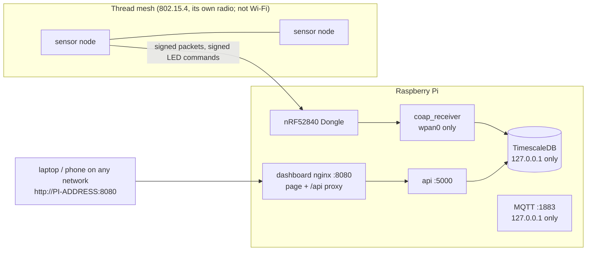

# Network and access: running G.O.S. on any network

The whole system runs on the Raspberry Pi. It works on whatever Wi-Fi or wired network the Pi
joins, at whatever address that network gives it, because nothing has a fixed address built in.

## What is reachable from the network

| Port | What | Reachable from | Protection |
|---|---|---|---|
| 8080 | dashboard and `/api` (nginx) | every network the Pi is on | reads open; every change needs the API token |
| 5000 | API directly (scripts) | every network the Pi is on | same token |
| 3000 | Grafana | every network the Pi is on | Grafana login (`GF_SECURITY_ADMIN_PASSWORD`) |
| 5432 | database | the Pi only (`DB_BIND`) | password; opening it to the network is not recommended |
| 1883, 9001 | MQTT | the Pi only (`MQTT_BIND`) | anonymous by default, so kept local; add a `password_file` before opening it |
| 5683/udp | node packets | the Thread interface only (`wpan0`) | per-node HMAC key, replay counter |

The sensor nodes do not use Wi-Fi at all: they talk to the Pi's nRF52840 Dongle over Thread,
so changing the Wi-Fi does not affect them.

## Finding the Pi on a new network

- Its address: `hostname -I` on the Pi, or the router's client list.
- By name: Raspberry Pi OS runs avahi, so `http://<hostname>.local:8080` works on most home and
  lab networks (not on some enterprise networks that block mDNS).
- From anywhere (off-site): put the Pi on a VPN such as Tailscale or WireGuard and use its VPN
  address. This is also the safe way to reach it over the internet; do not port-forward 8080.

## The API token

Reading needs nothing. Every change (set LEDs, end an override, log an event or harvest, use
the assistant) needs `Authorization: Bearer <GOS_API_TOKEN>`.

1. In `.env` on the Pi (git-ignored): `GOS_API_TOKEN=<48 hex digits>`. Generate one with
   `python -c "import secrets; print(secrets.token_hex(24))"`. Without it the API is read-only;
   tokens shorter than 16 characters are refused.
2. Restart: `docker compose up -d api`.
3. In the dashboard: open **Access** at the top right, paste the token, **Save token**. The
   browser keeps it (per server); **Forget** removes it.
4. Scripts send it as a header:
   `curl -X POST http://<pi>:8080/api/led -H "Authorization: Bearer $GOS_API_TOKEN" -H "Content-Type: application/json" -d '{"node":"ALL","blue_pct":30,"red_pct":70,"minutes":0}'`

Why a header and not a login cookie: a browser attaches cookies to every request automatically,
including requests that a malicious page makes. It never attaches this header by itself, so no
other web site can make a visitor's browser change the lights (no cross-site request forgery).

## Questions that came up

| Question | Answer |
|---|---|
| Can other sites use the API? | Yes, if you list them: `GOS_CORS_ORIGINS=https://site-a,https://site-b`, or `*` for any site. Their pages can read; to change anything they still need the token, which they only have if you give it to them. Default: no other sites (the dashboard needs no entry, it uses the same address). |
| Can the dashboard talk to another G.O.S. server? | Yes: **Access** > "Other G.O.S. server". The choice is stored in the browser and never taken from the page link, so a crafted link cannot redirect the dashboard or its token. Each server keeps its own token. The other server must list this dashboard's address in its `GOS_CORS_ORIGINS`. |
| Can a manual LED setting stay on? | Yes: tick **Keep until I switch back to automatic** (API: `"minutes": 0`). Timed settings go up to 90 days. The safety monitor (dark period, 32 C cut-off, ramp limit) still applies, and the node still switches off if the gateway goes silent for 15 minutes. |
| Are the assistant limits needed? | A cap on note length (8000 characters) and requests (30 per minute per client) protects a paid Claude account and the Pi's CPU. Both are settings: `ASSISTANT_MAX_CHARS`, `ASSISTANT_RATE` (0 = no limit). |
| Is it safe on any Wi-Fi? | On networks you trust (lab, home): yes. On public or shared Wi-Fi, anyone on that network can read the dashboard, and since it is plain http they could capture the token as it is sent. Use a VPN (Tailscale / WireGuard) there, or put HTTPS in front (for example Caddy with a certificate). The token can be changed at any time in `.env`. |

## Settings (`.env`)

| Setting | Default | Meaning |
|---|---|---|
| `GOS_API_TOKEN` | empty (read-only) | token for changes |
| `GOS_CORS_ORIGINS` | empty | other web sites allowed to call the API from a browser; `*` = any |
| `ASSISTANT_MAX_CHARS`, `ASSISTANT_RATE` | 8000, 30 | assistant limits; rate 0 = none |
| `DB_BIND`, `MQTT_BIND` | 127.0.0.1 | 0.0.0.0 opens the database / MQTT to the network |
| `LED_TZ`, `LED_DARK_START`, `LED_DARK_END` | America/Toronto, 22, 6 | photoperiod of the safety monitor |
