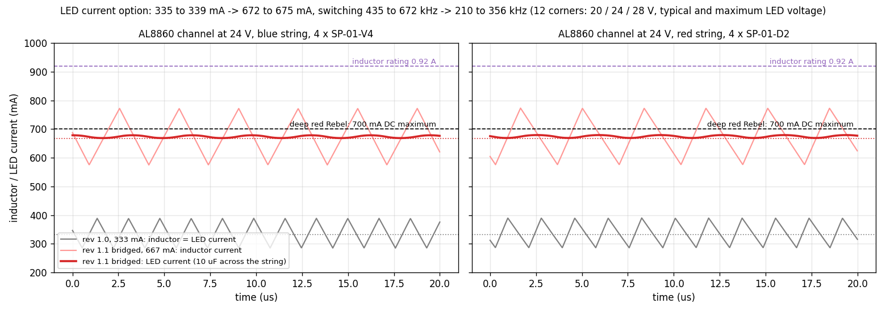
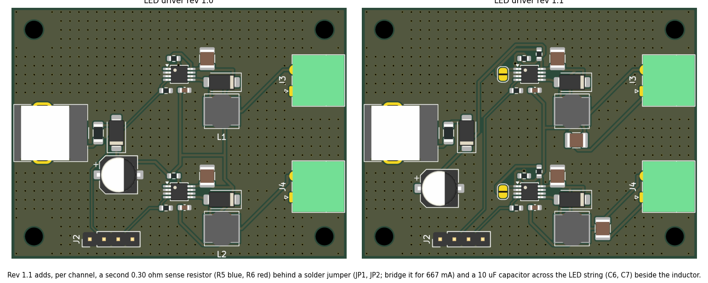
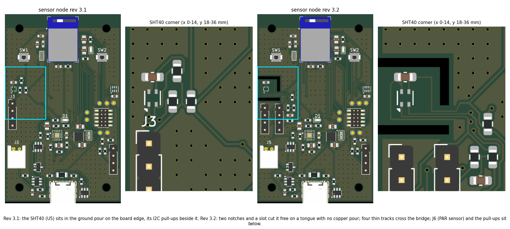
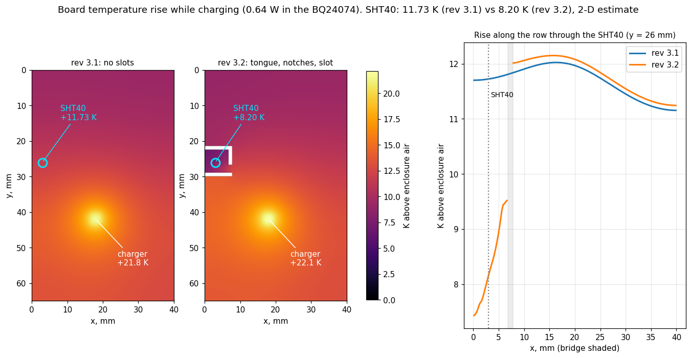

# Revision 3.2: before and after

The three hardware changes that `system_review.md` proposed for "revision 3.2", made on
2026-11-22, and what each one changed: sensor node rev 3.1 to rev 3.2, LED driver rev 1.0 to
rev 1.1. The old boards are kept, unchanged, in `pcbs/archive/` (KiCad files, generator scripts,
BOM, `fab/` ready to order, `docs/`).

Nothing here has run on real boards yet. Every result below comes from a design tool, a
simulation or a test, and says which.

## Summary

*Table 1. The three changes: what was wrong, what changed, and how it was checked.*

| # | Board | Problem in the old revision | Change | Checked by | Result |
|---|---|---|---|---|---|
| 1 | LED driver 1.0 -> 1.1 | one LED board adds only about 120 umol m-2 s-1 over 0.25 m2: a spectral supplement, not a grow light | per channel: a second 0.30 ohm sense resistor behind an open solder jumper (R5 + JP1 blue, R6 + JP2 red). Bridged: 0.15 ohm, 667 mA. Plus a 10 uF capacitor across each LED string (C6, C7) | LTspice, 12 corners (20 / 24 / 28 V, typical and maximum LED voltage), and PWM dimming | 672 to 675 mA, LEDs peak at 680 mA (under 700 mA), inductor peak 0.775 A (rated 0.92 A), 210 to 356 kHz, 92 to 96 % efficient; jumper open: identical to rev 1.0; PWM dimming stays proportional |
| 2 | sensor node 3.1 -> 3.2 | the TSL2591 measures lux, a poor measure of photosynthetic light under narrow-band red and blue LEDs | J6: input for a self-powered quantum (PAR) sensor, through R24 1k + C15 100 nF to AIN1; firmware reads it (SAADC gain 4, 256x oversampling) and sends it in PACKET_V5; the gateway stores it and the biology engine takes the LED share off | ERC, DRC, firmware builds, host packet test, gateway and ML tests | all six firmware builds pass; packet test 4 of 4; gateway 88 and ML 15 tests pass |
| 3 | sensor node 3.1 -> 3.2 | charging warms the board (0.64 W in the BQ24074) and the SHT40 reads high | the SHT40 sits on a tongue cut free by two notches from the board edge and a slot, with no ground pour, no planes and no vias on it; four 0.127 mm tracks cross a 2.2 mm FR-4 bridge | 2-D finite-difference thermal model of the board | 11.7 K -> 8.2 K above the enclosure air while charging (30 % less), estimate |

## 1. LED current option (LED driver rev 1.1)

**Before (rev 1.0):** R1 / R3 = 0.30 ohm between VIN and SET: the AL8860 regulates 0.1 V across
it, 333 mA per channel. **After (rev 1.1):** the same, plus R5 / R6 (0.30 ohm) joined in
parallel by bridging JP1 / JP2 with solder: 0.15 ohm, 667 mA. As delivered the jumpers are open,
so a rev 1.1 board behaves like rev 1.0 until a jumper is bridged.

The LED datasheet limit decides the details. Luxeon Rebel deep red: 700 mA DC maximum, binned
at 350 mA; royal blue: characterised at 700 mA (Lumileds DS68, as listed by LEDSupply). The
AL8860 is a hysteretic buck: the inductor current ramps about +/-15 % around the set value. At
667 mA that ramp peaks near 775 mA, above the deep red's 700 mA, so rev 1.1 also puts a 1 uF
capacitor across each LED string (C6, C7). The inductor still ramps; the LEDs see the average.
A 1 uF part was tried first: with about 0.5 uF left at the string's 12 V bias its impedance at
300 kHz is close to the string's own 1.7 ohm, so the LEDs still peaked at 710 to 730 mA. 10 uF
(about 4.7 uF at bias) holds them at 680 mA. The capacitor holds the string voltage when the
AL8860 switches off, so PWM dimming was checked again (`led_pwm_rev11.cir`): still proportional.

*Table 2. One AL8860 channel in LTspice, 12 corners each (20 / 24 / 28 V supply, blue and red
strings, typical and maximum LED voltage): rev 1.0 against rev 1.1 with the jumper bridged.*

| Quantity | Rev 1.0 (333 mA) | Rev 1.1, jumper open (333 mA) | Rev 1.1, jumper bridged (667 mA) | Limit |
|---|---|---|---|---|
| LED current, average | 335 to 339 mA | 335 to 339 mA | 672 to 675 mA | deep red 700 mA DC |
| LED current, peak | 392 mA (no capacitor: the inductor ramp) | 340 mA | 680 mA | 700 mA |
| Inductor current, peak | 392 mA | 392 mA | 775 mA | 0.92 A rating |
| Switching frequency | 435 to 672 kHz | 434 to 672 kHz | 210 to 356 kHz | 1 MHz maximum |
| Switch on-time | 545 to 1566 ns | 546 to 1566 ns | 1.07 to 3.42 us | 500 ns minimum (4 % accuracy) |
| Duty | 32 to 68 % | 32 to 68 % | 35 to 72 % | 25 to 75 % recommended |
| Efficiency | 94 to 97 % | 94 to 97 % | 92 to 96 % | |
| AL8860 switch loss (0.2 ohm model) | 7 to 15 mW | 7 to 15 mW | 32 to 65 mW | small in MSOP-8EP |
| Sense resistor power (each 0.30 ohm resistor) | 34 mW | 34 mW | 34 mW each (68 mW in two) | 100 mW (0603) |
| PWM dimming 10 / 50 / 90 % at 250 Hz | 33.7 / 168.4 / 303.0 mA | 33.7 / 168.4 / 303.1 mA | 67.5 / 337 / 607 mA | proportional to duty |

*Figure 1. Inductor current of one channel at 24 V for the blue and red strings, rev 1.0
(333 mA, grey) against the 667 mA option (red). The ramp is the AL8860's hysteresis; the dashed
lines are the deep red LED's 700 mA limit and the inductor's 0.92 A rating. The thick red line
is the LED current at 667 mA behind the new 10 uF capacitor: the inductor ramps from 575 to
775 mA, the LEDs stay between 668 and 680 mA.*

*Figure 2. LED driver rev 1.0 (left) and rev 1.1 (right), 3D render of the top side. New on rev
1.1: R5 and JP1 beside the blue AL8860 (top), R6 and JP2 beside the red one (bottom), and the
10 uF capacitors C6 and C7 beside the inductors. Same 60 x 45 mm board, same connectors.*

What else bridging a jumper changes, and has to be allowed for:

*Table 3. System effects of the 667 mA option.*

| Item | 333 mA (as delivered) | 667 mA (jumper bridged) | Check |
|---|---|---|---|
| LED electrical power, both channels at 100 % | about 7.4 W | about 14.8 W | LTspice P_in, typical LEDs, 24 V |
| 24 V adapter (Mean Well GST36U24, 1.5 A) | 0.3 A | 0.7 A worst case (maximum LED voltage) | inside its rating |
| F1 PTC (1.1 A hold) | 0.3 A | 0.7 A | holds |
| Heatsink | about 2 C/W per channel | about 1 C/W per channel | heat in the LEDs roughly doubles |
| Light at the canopy | about 120 umol m-2 s-1 | up to about 240 umol m-2 s-1 (upper bound: LED efficacy falls with current) | measure with the quantum sensor (change 2) |
| Plant model and controller | `LedParams.for_current(333)` | `LedParams.for_current(667)` | set it to match the jumpers |

## 2. PAR (quantum) sensor input (sensor node rev 3.2)

**Before:** light came only from the TSL2591 (lux). Under narrow red and blue LEDs lux and
photosynthetic photon flux disagree; the biology engine estimated daylight PPFD from lux after
taking off the LEDs' calculated share. **After:** J6 takes a self-powered quantum sensor (for
example Apogee SQ-500-SS, full spectrum, 0.01 mV per umol m-2 s-1, 0 to 40 mV); the node sends
PAR directly. The lux reading stays, so rev 3.1 boards and nodes without a sensor work as before.

*Table 4. The PAR path from sensor to plant model, before and after.*

| Layer | Rev 3.1 | Rev 3.2 |
|---|---|---|
| Board | no input | J6 (1x4 2.54 mm: GND/shield, signal, GND, +3V3), R24 1k + C15 100 nF (RC 0.1 ms, limits cable transients), AIN1 / P0.03 |
| Firmware | lux only | `CONFIG_GOS_PAR_SENSOR` (`par_sensor.conf`): SAADC channel 1, gain 4 (0.15 V full scale, 37 uV per count), 256x oversampling, calibration factor `CONFIG_GOS_PAR_UMOL_PER_MV` (default 100) |
| Packet | PACKET_V4, 43 bytes | PACKET_V5, 45 bytes: PAR u16 at offset 20, 0xFFFF = no sensor; builder moved to `src/packet.c` (no Zephyr calls) |
| Gateway | `par_umol` empty for nodes | stores PAR in `raw_telemetry.par_umol`, `payload.par_source = "node"`; V4 and V3 still accepted |
| Biology engine | daylight PPFD from lux minus the LEDs' calculated share | daylight PPFD = measured PAR minus the LEDs' share (the sensor sees the LED board too); lux only when no PAR |

*Table 5. Tests for the PAR path.*

| Test | Result |
|---|---|
| Schematic: ERC, netlist parity, footprint pins (`generate_schematics.py --verify`) | 0 violations, 49 nets |
| Board DRC with schematic parity | 0 violations, 0 unconnected, 0 parity (KiCad DRC, every severity); LED driver rev 1.1 the same |
| Firmware builds, all six variants (bench, climate, climate locked, light node, and the two with `par_sensor.conf`) | all build; PAR adds 0.2 KB of flash |
| Host test `tests/host/test_packet.c`: the C packet builder against the gateway's format | 4 of 4 |
| Gateway tests (5 new: V5 decode, no-sensor value, altered bytes fail, stored, V4 has no PAR) | 88 passed |
| ML tests (2 new: node PAR has the LED share removed, never negative; 667 mA parameters) | 15 passed |
| End to end in Docker (production images): the fake node sends PACKET_V5 with PAR; new check that PAR reaches the database; the override check now sends 5 packets so the 25 % ramp limit cannot fail it | 17 of 17 checks pass |

Resolution with an SQ-500-SS: one SAADC count is 37 uV, about 3.7 umol m-2 s-1; averaging 256
samples brings the noise well below one count. The SAADC's own offset (a few counts) reads as
a few umol m-2 s-1 in the dark; the firmware clamps negative readings to 0.

## 3. SHT40 thermal isolation (sensor node rev 3.2)

**Before:** the SHT40 sat on the board edge with ground pour on the outer layers and both inner
ground planes under its surroundings. The planes spread the charger's heat across the whole
board. **After:** two 1.0 mm notches milled in from the left edge and a 1.0 mm slot cut out a
6.8 x 6.4 mm tongue; no pour, no planes and no vias on it; the four sensor tracks (0.127 mm,
laid by hand) leave over a 2.2 mm FR-4 bridge, ending on vias where the autorouter takes over.

*Figure 3. Sensor node rev 3.1 and rev 3.2, 3D renders of the top side with close-ups of the SHT40
corner (cyan box). Rev 3.1: the SHT40 in the copper pour, its I2C pull-ups beside it. Rev 3.2:
the two notches and the slot (black) cut the tongue free; no pour on it (darker green); four thin
tracks leave over the bridge to vias; J6 (PAR sensor) sits beside J3, with R24, C15 and the
pull-ups below.*

*Figure 4. Board temperature rise while charging (0.64 W in the charger, U1), rev 3.1 (left)
against rev 3.2 (middle), and along the row through the SHT40 (right). The rest of the board
warms about the same; the tongue stays cooler because heat reaches it only through the bridge
and the four thin tracks. Steady-state 2-D model, h = 10 W/m2 K on both faces.*

*Table 6. Slot designs compared in the thermal model (SHT40 rise above the enclosure air while
charging; rev 3.1: 11.7 K).*

| Design | SHT40 rise | Less than rev 3.1 |
|---|---|---|
| closed slots, 0.8 mm strips left at the edge, 0.2 mm tracks (first attempt) | 9.9 K | 16 % |
| slots open to the edge, 0.2 mm tracks | 9.2 K | 21 % |
| open to the edge, 1.5 mm bridge, 0.2 mm tracks | 8.0 K | 32 % |
| **as built: notches open to the edge, 2.2 mm bridge, 0.127 mm tracks** | **8.2 K** | **30 %** |
| lower bound: same with no copper at all on the tongue (impossible: it needs four tracks) | 4.6 K | 61 % |

The model shows where the heat gets in: mostly through the copper tracks, then through any
copper-bearing strip left at the edge. The bridge is 2.2 mm, not 1.5 mm, because four tracks
plus the board's 0.5 mm copper-to-edge clearance on both sides need it. A smaller tongue or
longer tracks would help a little more; the rest of the error comes from the whole board warming,
which only a lower charge current or measuring outside the enclosure removes. The packet's
charging flag stays: filter readings taken while charging.

## Other parts that changed with them

*Table 7. Everything else changed for revision 3.2.*

| Part | Before | After |
|---|---|---|
| Sensor enclosure | one M12 gland, right wall (LED cable) | plus an M12 gland in the left wall for the PAR cable (`par_gland`); fit check: clear of the SHT40 vents |
| Board generator | rectangular outline | outline polygon with the notches; slot keep-outs at the 0.5 mm edge clearance; hand-laid tongue tracks ending on vias |
| Router script | stopped on any DRC violation | retries when the violation is one a new routing pass can clear (shorts, clearance, dangling), removes vias joined on one layer only |
| Ordering | | quantum sensor (Apogee SQ-500-SS or equal), second M12 gland; on the LED board 2 x 10 uF 50 V capacitors and 2 x 0.30 ohm resistors (assembled by JLCPCB) |
