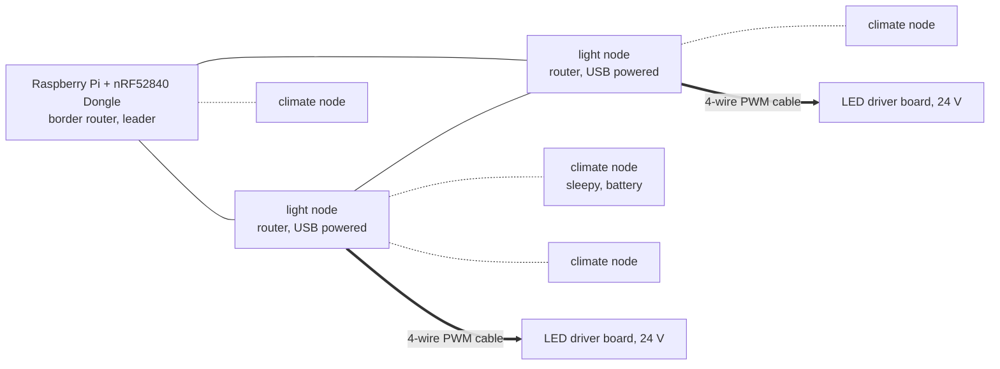

# System review: does every part fit the others?

A check of the whole project as one system, boards, firmware, enclosures, gateway, models and
dashboard, against what it has to do: measure the climate around strawberry plants, and set a
blue/red LED mix per plant group, in a phytotron, for research. For each part: does it fit,
what was changed now, and what a next revision should change. 2026-11-15.

## Verdict

The parts fit together and the software path is tested end to end (simulated node to signed
LED command and back, dashboard, dataset, Grafana). Three things did not fit and are fixed in
this round; four are limits of the current hardware that the deployment plan below works
around, and that a hardware revision 3.2 should remove. Nothing has run on real boards yet.

## Deployment plan that fits the current hardware

Two kinds of sensor node, same board, different firmware build:

| Role | Where | Power | Firmware build | Why |
|---|---|---|---|---|
| **Light node** | at each grow light, with an LED driver board | USB-C, 5 V adapter (the LED board's 24 V adapter cannot power it) | `router.conf` (Thread router) | radio always on: relays for its neighbours, so the network is a real mesh; LED commands arrive at once |
| **Climate node** | anywhere a measurement is needed, no LED board | 18650 cell | default, field: `low_power.conf` (+ `lock.conf`) | sleepy end device, 30 s poll, months on a cell |

A light node must be on USB power: when the LEDs are dimmed (not 0 or 100 %), the PWM keeps the
nRF52840's 16 MHz clock running, and as a router its radio receiver is on all the time. A climate
node never drives an LED board, so it sleeps.

## Part by part

| Part | Fits? | Finding | Done now / proposal |
|---|---|---|---|
| Thread network | **did not** | Every node was a sleepy end device. Sleepy devices never relay, so each node had to reach the border router directly: no mesh, despite the README. (Capacity was fine: the OpenThread host build allows 64 children.) | **Fixed**: `router.conf` build (Thread FTD) for USB-powered nodes; plan above. Builds: 262 KB flash, 71 KB RAM. |
| Node power | partly | Thread poll every 1 s cost an estimated 20 to 40 uA, more than the rest of the sleeping board together. | **Fixed**: 30 s poll, fast polls for 2.5 s after each packet so the LED reply still arrives in about a second. Estimated average about 20 to 30 uA (floor 14 uA, polls about 1 uA, one packet and its fast polls a minute; not measured). |
| Key protection | partly | Node signing key and Thread key readable with a debugger. | **Added** `lock.conf` (nRF APPROTECT). Re-provision before reflashing a locked node. |
| ML dataset | **did not** | Joined the requested LED schedule, not what the lights did; no plant-model columns; the API could not serve the file (no data mount). | **Fixed**: joins `led_commands` and `plant_state` per node; API mounts `data/`. |
| LED decisions | **did not** | `/api/phenotype` gave its own fixed LED rule, contradicting the controller. | **Fixed**: one source of LED decisions (controller + manual), the endpoint points to it. |
| Simulator | partly | 40 simulated nodes ran in every deployment unless the compose file was edited, mixing with real data. | **Fixed**: `--profile sim` only. |
| Grafana | **did not** | Fixed database password in its datasource (wrong with any `.env`), no dashboards, plugins downloaded at every start. | **Fixed**: credentials from `.env`, a provisioned phytotron dashboard, pinned 13.2.6, no plugin downloads. |
| LED board light output | limit | 2 x 4 one-watt LEDs at 333 mA give about 120 umol m-2 s-1 over 0.25 m2. That is a spectral treatment and supplement, not a main grow light; the trained policy correctly keeps it at full most days. | Proposal 3.2: a 700 mA option (sense 0.15 ohm; the royal blue star's figures are given at 700 mA, the deep red's at 350 mA, so check the red's rating; recheck the inductor's 0.92 A rating and AL8860 heating in LTspice) or longer strings. Measure the real output with a PAR sensor first (`LedParams`). |
| Light sensor | limit | TSL2591 measures lux, which under narrow-band red/blue LEDs is a poor measure of photosynthetic light. The biology engine subtracts the LEDs' own share (it knows their level), so daylight PPFD is estimated; the LED share is computed. | Proposal 3.2: a PAR (quantum) sensor input, or calibrate lux to PAR once per installation. |
| SHT40 near the charger | limit | Charging warms the board; readings during charging read high. | Mitigated: the packet carries a charging flag and the dataset can filter on it. Proposal 3.2: routed slot around the SHT40. A light node on USB charges only briefly once the cell is full. |
| Enclosures | fits | Board, cradle, vents, light tube and cut-outs generated from the KiCad files; 12 fit checks. | Light nodes: the USB cable uses the existing cut-out; add a strain relief clip when printing. |
| LED driver | fits | Simulated (frequency, current, dimming, fail-safe); off when the cable is unplugged or the node resets. | Nothing now. |
| Gateway, API, dashboard | fits | Tested end to end, token, any network. | Nothing now. |
| Models | fits | Plant model, PPO, Chronos all run on the Pi, offline. | Calibrate the plant model on the real cultivar; retrain PPO with measured LED output. |

## Firmware builds

| Build | Command (`west build -b raytac_mdbt50q_db_40/nrf52840 pcbs/gos_sensor_node/firmware --`) | Flash / RAM |
|---|---|---|
| Bench (logging) | (none) | 214.6 KB / 62.4 KB |
| Climate node, field | `-DEXTRA_CONF_FILE=low_power.conf` | 197.3 KB / 60.1 KB |
| Climate node, field, locked | `-DEXTRA_CONF_FILE="low_power.conf;lock.conf"` | 197.3 KB / 60.1 KB |
| Light node (router) | `-DEXTRA_CONF_FILE=router.conf` | 261.6 KB / 70.6 KB |

All four compile with no warnings from the project's code (Zephyr main f8da8ea, SDK 1.0.1). The
devicetree of the bench and field builds also compiles with `dtc` 1.7.2.

## Priorities

1. Order and build two nodes and one LED board; run `bring_up.md` (sleep current, Thread range,
   LED current). Everything else depends on real measurements.
2. Measure LED PPFD at plant height; set `LedParams`; retrain the policy.
3. Decide on revision 3.2 changes from the measurements: SHT40 slot, PAR input, LED current.
