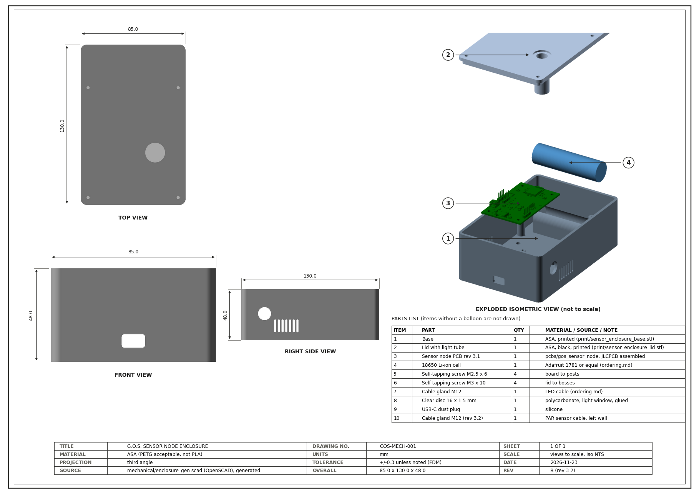
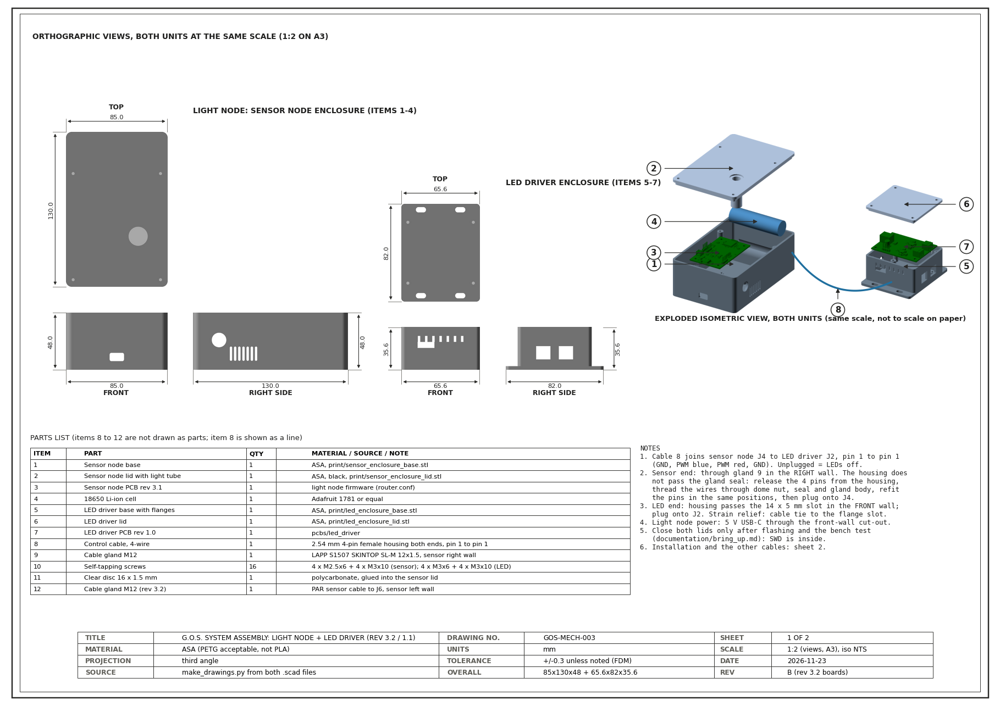
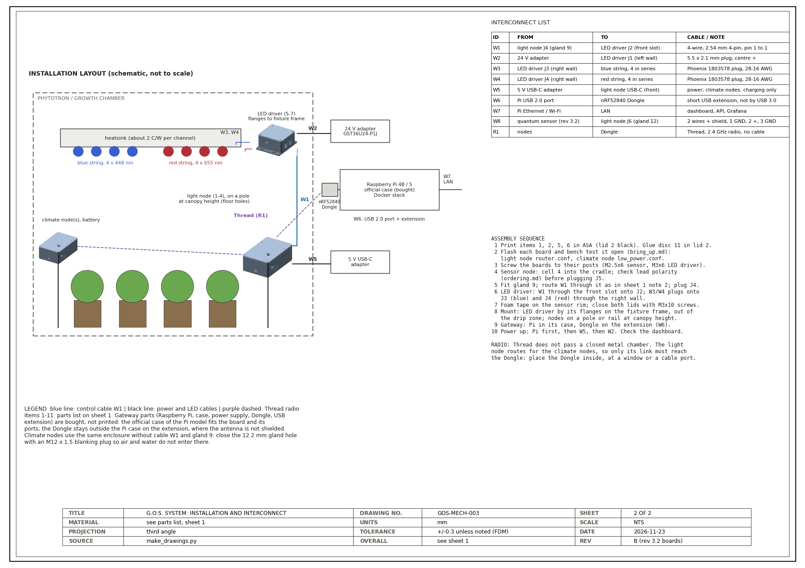

# Enclosures

Two parametric OpenSCAD enclosures, one per board. Board positions come from files that
`fit_check.py` writes from the KiCad boards, so posts, cut-outs and windows follow the boards.

*Table 1. The two enclosures, what each holds and its outside size.*

| File | Holds | Outer size |
|---|---|---|
| `enclosure_gen.scad` | sensor node + one 18650 cell | 85 x 130 x 48 mm (with lid) |
| `led_enclosure.scad` | LED driver board | 65.6 x 62 x 36 mm (with lid), plus 10 mm mounting flanges |

Print-ready STL files (base and lid of each, in print orientation): `print/`.


*Figure 1. Sensor node enclosure with the lid raised (rev 3.2), seen from the front left: the board by the USB-C cut-out, the 18650 cell in its cradle at the back, the light tube hanging from the lid, vents in both side walls, the PAR sensor cable gland hole in the left wall (front) and the LED cable gland hole in the right wall. Rendered with `openscad -o ../docs/images/sensor_enclosure_exploded.png --imgsize=1400,1100 --camera=0,0,30,55,0,325,420 -D show_pcb=true -D lid_lift=45 enclosure_gen.scad`.*


*Figure 2. LED driver enclosure with the lid raised: the board on four posts, vents along both long walls, the LED-plug openings in the right wall, and the mounting flanges with their slots.*

## Engineering drawings

`make_drawings.py` makes one drawing sheet per enclosure in `docs/images/drawings/`: third-angle
orthographic views (top, front, right side) with overall dimensions measured from the exported
model, an exploded isometric view with numbered balloons, a parts list and a title block.
Run it after `fit_check.py` (which exports the board models it draws).



*Figure 3. Drawing GOS-MECH-001, sensor node enclosure: three views with overall dimensions, exploded view with balloons, parts list and title block.*


*Figure 4. Drawing GOS-MECH-002, LED driver enclosure: three views with overall dimensions, exploded view with balloons, parts list and title block.*

It also makes the system assembly drawing GOS-MECH-003 (two sheets), for putting the units
together after printing:

- **Sheet 1**: the light node and the LED driver in third-angle views at the same true scale
  (1:2 on A3), one exploded view of both with the control cable, a combined parts list (items
  1 to 11) and assembly notes.
- **Sheet 2**: installation layout in the growth chamber, interconnect list (cables W1 to W7,
  radio R1), assembly sequence and where to put the Thread Dongle.

`python make_drawings.py --system` makes only GOS-MECH-003 (about 10 minutes, mostly OpenSCAD
renders); `--sheet2` only its second sheet.



*Figure 5. Drawing GOS-MECH-003, sheet 1: both enclosures at the same scale (1:2 on A3), one exploded view of both with the control cable, combined parts list and cable-routing notes.*



*Figure 6. Drawing GOS-MECH-003, sheet 2: installation layout, interconnect list W1 to W7, assembly sequence and Dongle placement.*

**Gateway (Raspberry Pi + nRF52840 Dongle)**: bought boards, no printed enclosure. Use the
official case for the Pi model; put the Dongle on a short USB extension in a USB 2.0 port,
outside the case (USB 3.0 ports radiate in the 2.4 GHz band, and a case or a metal chamber wall
shields the antenna). If the growth chamber is metal and closed, put the Dongle inside it, at a
window or a cable port: the light node routes for the climate nodes, so only its link must reach
the Dongle.

**Climate nodes** use the same enclosure as the light node without the LED cable: close the
gland hole with an M12 x 1.5 blanking plug.

**Getting the control cable through the gland**: the 2.54 mm housing does not pass the gland's
seal. Release the four crimped pins from one housing (lift each latch with a needle), thread the
wires through the dome nut, seal and gland body, then refit the pins in the same positions.

## Fit check

```
"C:\Program Files\KiCad\9.0\bin\python.exe" fit_check.py
```

1. Reads both KiCad boards and writes `pcb_layout.scad` and `led_layout.scad`.
2. Checks the fit and exits non-zero on a failure. Sensor node: posts inside the walls, USB-C
   socket face 0.3 mm inside the front wall, battery cradle behind the board, 18650 can at least
   10 mm from the antenna (35.6 mm), cradle fits, battery lead reaches, lid clearance. LED board:
   jack and LED-terminal faces at the walls, lid bosses clear of the board, lid clearance.
3. Exports each board with its parts as STL (not committed) and renders `fit_check_*.png` and
   `led_fit_*.png`.
4. Writes the print STLs in `print/`.

Last result (2026-11-23, rev 3.2 boards): all 15 checks pass (3 new: the PAR cable gland clears the SHT40 vents by 5.9 mm and the front wall, and the J6 cable is about 45 mm). Rerun after any board change.

## Sensor node enclosure

*Table 2. Sensor node enclosure: each feature, where it is and why.*

| Feature | Where | Why |
|---|---|---|
| Board | four 5 mm posts, USB-C face 0.3 mm inside the front wall | cable reaches the socket through a 12 x 7 mm cut-out |
| 18650 cradle | across the back, snap-in | 35.6 mm from the module antenna: a metal can beside the antenna detunes it |
| Vents | vertical slots in both side walls, level with the SHT40 | air across the humidity sensor |
| Light window and tube | 10 mm hole in the lid over the TSL2591, a printed tube down to 3 mm above it, 16 x 1.5 mm clear polycarbonate disc glued into a recess on top | the light sensor sees outside light in a defined cone, not light reflected around inside; print the lid black |
| Cable gland | M12, right wall beside J4 | cable to the LED driver board (LAPP SKINTOP SL-M 12x1.5) |
| PAR cable gland (rev 3.2) | M12, left wall, 3 mm in front of the LED gland's position (`par_gland`, `par_gland_y`) | cable from the quantum sensor at canopy height to J6; fit check keeps the hole 3 mm or more from the SHT40 vent slots. Nodes without a sensor: M12 x 1.5 blanking plug, or print with `par_gland=false` |
| Lid | 3 mm with a locating lip, 4 x M3 screws into bosses | closed-cell foam tape on the rim for a dust seal |
| Floor | 2 x 4 mm mounting holes, 4 x 2 mm drain holes | pole or rail mounting; condensation drains |

## LED driver enclosure

*Table 3. LED driver enclosure: each feature, where it is and why.*

| Feature | Where | Why |
|---|---|---|
| Board | four 4 mm posts (M3) | |
| 24 V jack | round opening in the left wall at the jack | the plug enters from outside |
| LED strings | two openings in the right wall at J3 and J4 | the Phoenix 1803578 screw plugs enter from outside |
| PWM cable | 14 x 5 mm slot in the wall beside J2 | the cable from the sensor node; a 2.54 mm housing on J2 needs about 23 mm above the board |
| Vents | slots high on both long walls | each AL8860 channel dissipates about 0.25 W |
| Mounting | flanges on the long sides with 2 x 4.5 mm slots each | screw it to the light fixture or its frame, out of the plants' drip zone |

## Material and printing

*Table 4. Material and print settings. ASA survives the heat, UV and humidity of a lit phytotron; PLA would soften under the grow lights.*

| | Choice | Why |
|---|---|---|
| Material | **ASA** | UV-stable, heat resistant to about 95 C, low moisture uptake: suits a warm, humid, lit phytotron for years |
| Acceptable | PETG | indoor, out of direct light |
| Avoid | PLA | softens near 55 C and creeps under the screws; grow lights and summer temperatures reach that |
| Sensor-node lid | black | the light tube must not glow |
| Settings | 0.2 mm layers, 4 walls, 25 % infill; base open side up, lid upside down | |

To avoid printing yourself, send the four files in `print/` to an online printing service and ask
for ASA (see `documentation/ordering.md`).

Hardware: sensor node 4 x M2.5x6 (board) and 4 x M3x10 (lid) self-tapping screws; LED driver
4 x M3x6 (board) and 4 x M3x10 (lid). Plus the cable gland, the polycarbonate disc and a USB-C
dust plug for the sensor node's USB cut-out.

## Not verified

- Nothing has been printed. Pilot holes (2.2 mm for M2.5, 2.5 mm for M3) and the cradle snap fit
  depend on the printer; adjust `post_pilot_d`, `boss_pilot_d` and the cradle opening if needed.
- Connector heights come from the manufacturer drawings (USB-C socket centre about 1.6 mm above
  the board, PJ-063AH plug centre 5.0 mm); the openings allow 1.5 to 2 mm of error.
- The light window changes what the TSL2591 reads: calibrate lux with the lid on.
- The vents and the USB cut-out mean neither enclosure is waterproof (the humidity sensor needs
  air). Keep both out of direct spray.
