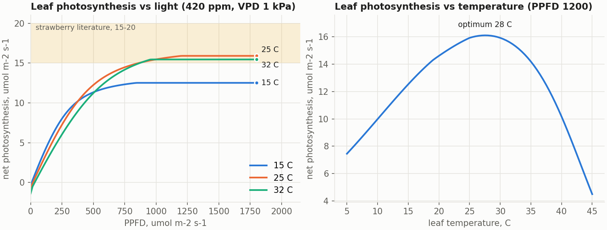
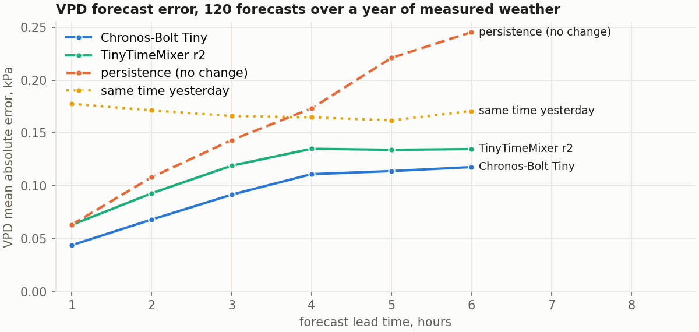

# Models used by G.O.S.

Every model the project runs, where it runs, where its weights are, and how it was checked.
Nothing runs on the sensor node: it measures, sends readings and applies LED levels. All models
run on the Raspberry Pi (or any Linux host) next to the database.

| Model | Job | Kind | Size | Where the weights are | License | Runs in |
|---|---|---|---|---|---|---|
| Strawberry canopy model (`../plant_model.py`) | photosynthesis, conductance, transpiration, VPD | mechanistic (FvCB, Medlyn, Penman-Monteith) | code only | this repository | project | `biology_engine` |
| LED policy (`led_policy.npz`) | blue and red LED level per node | PPO reinforcement learning, MLP 10-64-64-2, numpy inference | 22 KB | this repository | project | `ml_engine` (controller) |
| [Chronos-Bolt Tiny](https://huggingface.co/amazon/chronos-bolt-tiny) (`hf/chronos-bolt-tiny/`) | 2 h temperature and humidity forecast (default) | pretrained time-series foundation model (T5) | 8.7 M parameters, 34 MB | this repository, Hugging Face revision `a0e552de83495b5c28c14c71c374f3e33280b340` | Apache-2.0, Amazon | `biology_engine` |
| [Granite TinyTimeMixer r2](https://huggingface.co/ibm-granite/granite-timeseries-ttm-r2) (`hf/granite-timeseries-ttm-r2/`) | same, smaller alternative (`FORECAST_BACKEND=ttm`) | pretrained time-series model | 0.8 M parameters, 3.2 MB | this repository, revision `d6a79570cac0f33d526601cd3a0fc7c80a8f9a2f` (main: 512 h context, 96 h horizon) | Apache-2.0, IBM | `biology_engine` |
| [Qwen2.5-1.5B-Instruct](https://huggingface.co/Qwen/Qwen2.5-1.5B-Instruct), Q4_K_M | research notes to structured events (default) | small language model via Ollama | 986 MB | [GitHub release `models-2026-11-15`](https://github.com/johnnietse/strawberry-farm/releases/tag/models-2026-11-15) (over GitHub's 100 MB file limit for the repository itself), or the Ollama registry `qwen2.5:1.5b`; `fetch_models.sh` installs either | Apache-2.0, Qwen team (Alibaba Cloud) | `ollama` service |
| Claude (`claude-opus-5-5`, Anthropic API) | same, if `ANTHROPIC_API_KEY` is set | hosted model, JSON-schema output | hosted | not distributable | Anthropic terms | `api` |
| Keyword rules (`../../gateway/services/assistant.py`) | same, always available fallback | rules | code only | this repository | project | `api` |

Tested and not used: **Qwen2.5-0.5B-Instruct** (Ollama `qwen2.5:0.5b`) put 5 of 6 test notes in
the wrong category; 1.5B got all 6 right.

SHA-256 of the shipped weights:

```
75068728d376d2bec670379eeef4bfb4d24c0cfe24d957451f8d19b447030a32  hf/chronos-bolt-tiny/model.safetensors
a706726a7eb01bbcb42994b7dcb3c06ea9557898dbae8d480eb04fe8ccb89710  hf/granite-timeseries-ttm-r2/model.safetensors
183715c435899236895da3869489cc30ac241476b4971a20285b1a462818a5b4  qwen2.5-1.5b-instruct-q4_K_M.gguf (release)
```

The Apache-2.0 license text is in `hf/LICENSE-Apache-2.0.txt`; the model cards on Hugging Face
are the upstream documentation.

## How each one was checked

| Model | Check | Result | File |
|---|---|---|---|
| Canopy model | light, CO2 and temperature responses, Fick's law consistency | light-saturated 15.9 umol m-2 s-1 at 25 C (strawberry literature 15 to 20), optimum about 28 C | `../tests/test_plant_and_control.py` |
| LED policy | 60 held-out simulated days against four baselines | within 0.5 % of the model-based optimiser; numpy export matches torch to 0.00002 % | `led_policy_eval.json` |
| Chronos-Bolt Tiny, TTM r2 | 120 forecasts over a year of measured hourly weather (Kingston, ON), weights loaded offline from this folder | VPD error at 6 h: Chronos 0.118 kPa, TTM 0.135 kPa, persistence 0.245 kPa | `forecast_eval.json`, `../data/openmeteo_kingston_2025.json` |
| Qwen2.5-1.5B | 6 typical notes; end-to-end test through the API | 6 of 6 categories right, about 5 s per note on a PC CPU | `../../tests/e2e/run_e2e.sh` |




## Install and retrain

```bash
bash ml_engine/models/fetch_models.sh                                   # Qwen into Ollama
OLLAMA="docker compose exec -T ollama ollama" bash ml_engine/models/fetch_models.sh   # into the container
cd ml_engine && python train_rl.py --steps 600000                       # rewrites led_policy.npz
python eval_forecast.py --data data/openmeteo_kingston_2025.json       # rewrites forecast_eval.json
python plot_results.py                                                  # rewrites docs/images/ml/
```

Weather data: Open-Meteo historical archive (https://open-meteo.com), CC BY 4.0.
