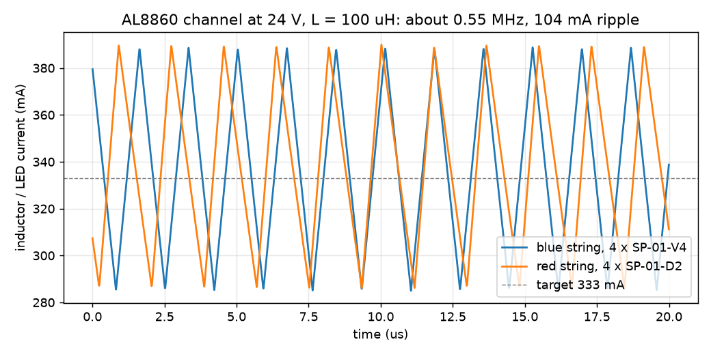
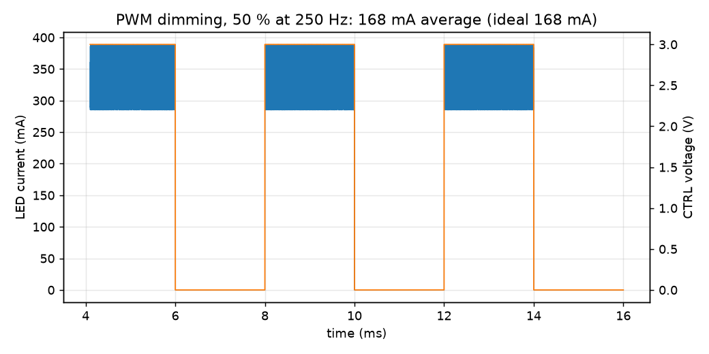
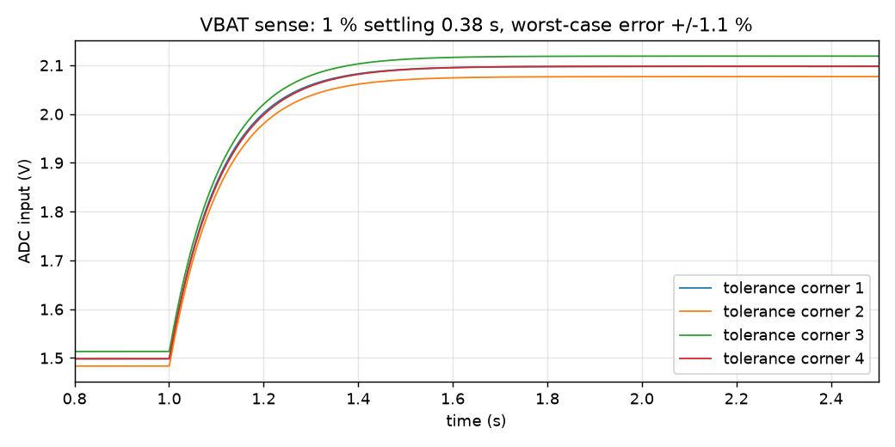
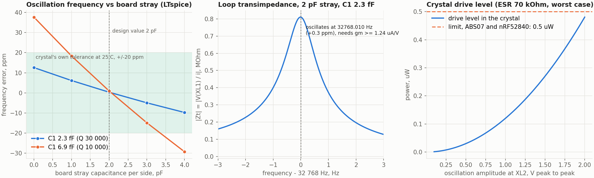
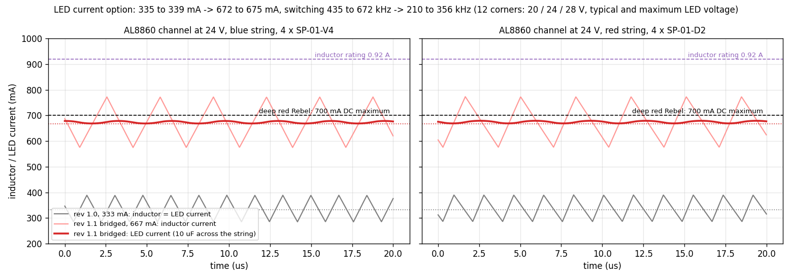
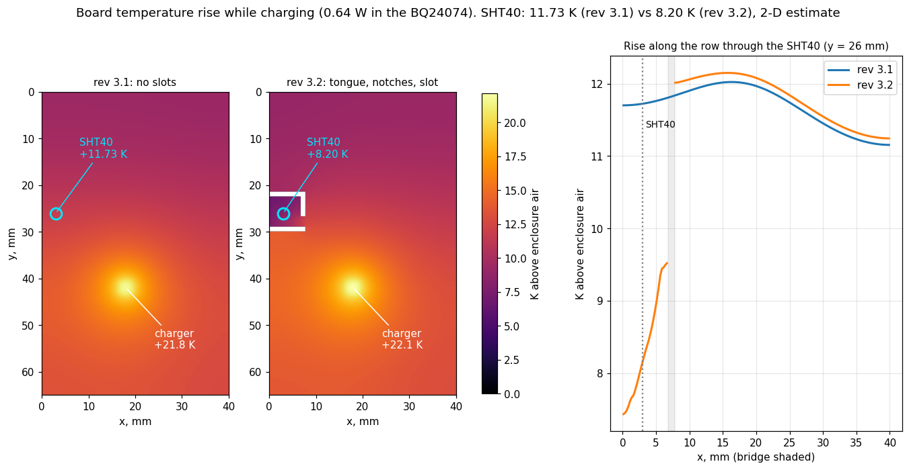

# Circuit simulations (LTspice)

LTspice netlists for the analog parts of both boards, with pass criteria taken from the part
datasheets. Open a `.cir` file in LTspice and run it; the `.meas` results appear in the log.
`plot_results.py` turns exported results into the plots in `plots/`.

Run with LTspice 26.1.1 on 2026-11-15; the revision 3.2 circuits and the thermal model on
2026-11-22 (before/after comparison: `documentation/rev3.2_changes.md`).

## Results

*Table 1. The LTspice circuits: what each models, what it was checked against, and the result.*

| File | Circuit | Checked against | Result |
|---|---|---|---|
| `led_channel.cir` | LED board: one AL8860 channel at full brightness, 20 / 24 / 28 V supply, blue and red strings, typical and maximum LED forward voltage (12 cases) | AL8860 datasheet: f below 1 MHz, on-time above 500 ns for 4 % accuracy, duty 25 to 75 %; inductor rating | **Pass** (after the change below): LED current 335 to 339 mA (target 333 mA, +0.6 to +1.7 %), 435 to 672 kHz, on-time 545 to 1566 ns, duty 32 to 68 %, inductor peak 392 mA (rated 0.92 A), efficiency 94 to 97 % |
| `led_pwm.cir` | LED board: 250 Hz PWM from the sensor node through R20 (100 ohm), the cable and the CTRL pull-down | CTRL above 2.5 V = full current; average current proportional to duty | **Pass**: 33.7 / 168.4 / 303.0 mA at 10 / 50 / 90 % (ideal 33.6 / 168 / 302 mA); CTRL high 3.0 V |
| `ctrl_failsafe.cir` | LED board: CTRL with the cable unplugged, worst-case AL8860 internal pull-up | CTRL below 0.2 V = LEDs off | **Pass** (after the change below): at most 0.12 V |
| `vbat_sense.cir` | Sensor node: 2.2 M / 2.2 M battery divider, 100 nF, SAADC sampling load; cell step 3.0 to 4.2 V; resistor tolerance corners | Reading accuracy and settling within the 60 s sample period | **Pass**: error +/-1.1 % worst case (+/-46 mV at 4.2 V) from the 1 % resistors, 0.1 % from sampling; 1 % settling 0.38 s; 0.96 uA standing drain |
| `crystal_lfxo.cir` | Sensor node: Y1 (ABS07-32.768KHZ-9) in the nRF52840 LFXO Pierce loop, 12 pF load capacitors, 4 pF pin capacitance, 0 to 4 pF board stray per side, motional capacitance 2.3 and 6.9 fF (from the datasheet's Q and ESR) | nRF52840 PS LFXO table (C_L max 12.5 pF, C0 max 2 pF, ESR max 100 kOhm, drive max 0.5 uW, +/-500 ppm for BLE), Nordic reference circuit (C_L 9 pF crystal, 12 pF NP0) | **Pass**: +0.3 to +0.9 ppm from 32.768 kHz at the design 2 pF stray; -29 to +38 ppm over 0 to 4 pF (the closed-form formula agrees within 1 ppm); minimum oscillator gm 1.0 to 1.5 uA/V; drive level reaches 0.5 uW only at 2 V peak to peak |
| `cell_reverse.cir` | Sensor node: 18650 the right way round and reversed, through Q2 (AO3401A) and Q1 (FS8205A), 500 mA load | No current and no voltage on the board when reversed | **Pass**: reversed, 0 V on the board and 8 pA from the cell; correct, 3.61 V on the board, 29 mV and 15 mW in Q2 |
| `led_channel_667mA.cir` | LED board rev 1.1, jumper bridged: R_SENSE 0.15 ohm, 10 uF across the LED string (about 4.7 uF at bias), same 12 corners | deep red Rebel 700 mA DC maximum, inductor 0.92 A, AL8860 limits as above | **Pass**: LED 672 to 675 mA average, 680 mA peak; inductor peak 775 mA; 210 to 356 kHz, on-time 1.07 to 3.42 us, duty 35 to 72 %; 92 to 96 % efficient. With 1 uF (0.5 uF at bias) the LEDs peaked at 730 mA: fail, so 10 uF |
| `led_channel_rev11_333mA.cir` | LED board rev 1.1, jumper open: 0.30 ohm with the new 10 uF capacitor | same as `led_channel.cir` | **Pass**: same as rev 1.0 (335 to 339 mA, 434 to 672 kHz); LED peak 340 mA instead of 392 mA |
| `led_pwm_rev11.cir` | PWM dimming at 250 Hz with the 10 uF capacitor, 0.30 and 0.15 ohm | average proportional to duty | **Pass**: 33.7 / 168.4 / 303.1 mA and 67.5 / 337 / 607 mA at 10 / 50 / 90 % |
| `thermal_sht40.py` (Python, not LTspice) | sensor node rev 3.1 against rev 3.2: 2-D steady-state board heat model, charger 0.64 W, natural convection 10 W/m2 K | how much the charger warms the SHT40 | rev 3.1 11.7 K, rev 3.2 8.2 K above the enclosure air (30 % less); estimate, measure on the bench |

*Figure 1. LED channel at 24 V: current in one AL8860 channel for the blue and red strings, about 0.55 MHz switching with 104 mA ripple around the 333 mA target.*

*Figure 2. PWM dimming at 50 % and 250 Hz: the LED current (blue) follows the CTRL voltage (orange) and averages 168 mA, exactly half of full.*

*Figure 3. Battery sense divider: the ADC input after the cell steps from 3.0 to 4.2 V at t = 1 s, for the four resistor-tolerance corners. It settles to 1 % in 0.38 s; the worst-case reading error is +/-1.1 %.*

*Figure 4. Crystal oscillator loop: frequency error against board stray capacitance (left), loop transimpedance showing where the loop oscillates and the gain it needs (middle), and the drive level in the crystal against its 0.5 uW limit (right).*

The crystal check: the oscillator amplifier inside the nRF52840 is not published, so the loop is
broken at its output and the frequency where the loop is purely real (where it must oscillate)
is found, together with the smallest gain that sustains it. Run `crystal_lfxo.cir`, export
`V(xl1)` with the LTspice MCP `export_raw_waveforms` to `crystal_lfxo.db`, then
`python plot_crystal.py crystal_lfxo.db`.

## Design changes these simulations caused

1. **LED inductor 47 uH to 100 uH (Bourns SRN6045TA-101M).** With 47 uH the AL8860 switched at
   0.86 to 1.27 MHz, above its 1 MHz recommended maximum, with on-times down to about 290 ns,
   below the 500 ns the datasheet needs for 4 % current accuracy. The datasheet's 47 uH example
   is for 1 A LEDs; at 333 mA the hysteresis band is a third as wide, so the frequency is three
   times higher. 100 uH (top of the datasheet's 33 to 100 uH range) halves it.
2. **CTRL pull-down 2.2 k to 1.5 k.** The AL8860 datasheet does not give the CTRL pull-up, but
   its shutdown current (CTRL grounded) is 80 uA maximum, so the pull-up can push at most
   80 uA. Through 2.2 k that is 0.176 V, 24 mV below the 0.2 V disable threshold; through 1.5 k
   it is 0.12 V. The node's PWM high level stays at 3.0 V, above the 2.5 V full-current level.

## What the models are, and what is not simulated

- **AL8860**: behavioural model built from datasheet DS39014 Rev. 8-2: hysteretic comparator
  on the R_SENSE voltage (115 / 87 mV thresholds from its threshold graph), 0.2 ohm switch,
  45 ns delay. Soft-start and the internal regulator are not modelled. Diodes Inc. does not
  publish an LTspice model for this part.
- **LEDs**: threshold plus 0.43 ohm per LED, fitted to the Luxeon Star SP-01-V4 (royal blue,
  2.9 V typ / 3.5 V max at 700 mA) and SP-01-D2 (deep red, 2.1 V typ / 2.8 V max at 350 mA)
  product pages.
- **MOSFETs (Q1, Q2)**: generic VDMOS fits to the datasheet threshold and on-resistance, not
  vendor models.
- **Not simulated**: the TPS62740 buck and BQ24074 charger (TI publishes PSpice models only),
  the nRF52840 radio module, the I2C sensors, firmware and the Thread network. These need
  bench measurements; `documentation/bring_up.md` lists them.

*Figure 5. LED driver rev 1.1 at 24 V: inductor current at 333 mA (grey) and 667 mA (light red), and the LED current at 667 mA behind the 10 uF capacitor (thick red), which stays between 668 and 680 mA, under the deep red LED's 700 mA. Made by `plot_led_option.py` from both runs.*

*Figure 6. Board temperature rise while charging, rev 3.1 against rev 3.2 (`thermal_sht40.py`): the SHT40 on rev 3.2's tongue warms 8.2 K instead of 11.7 K above the enclosure air.*
